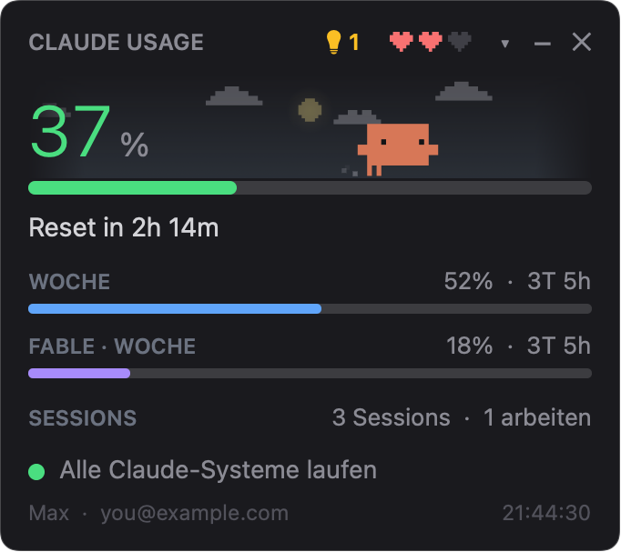
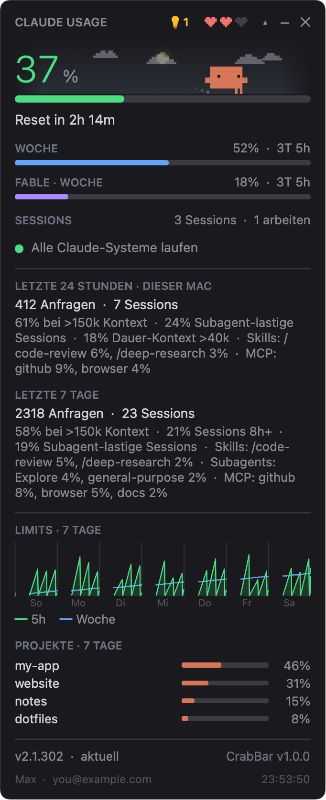
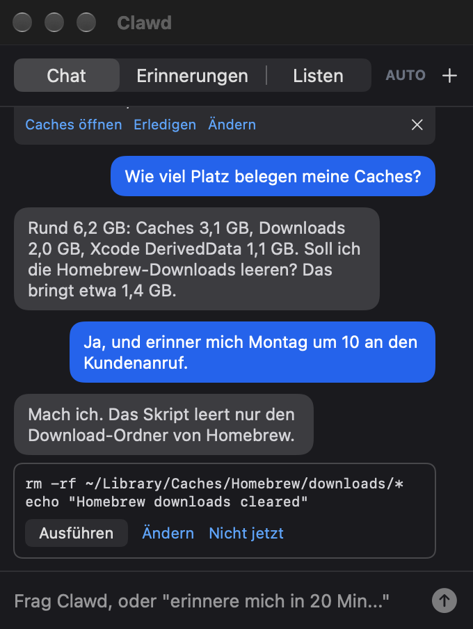
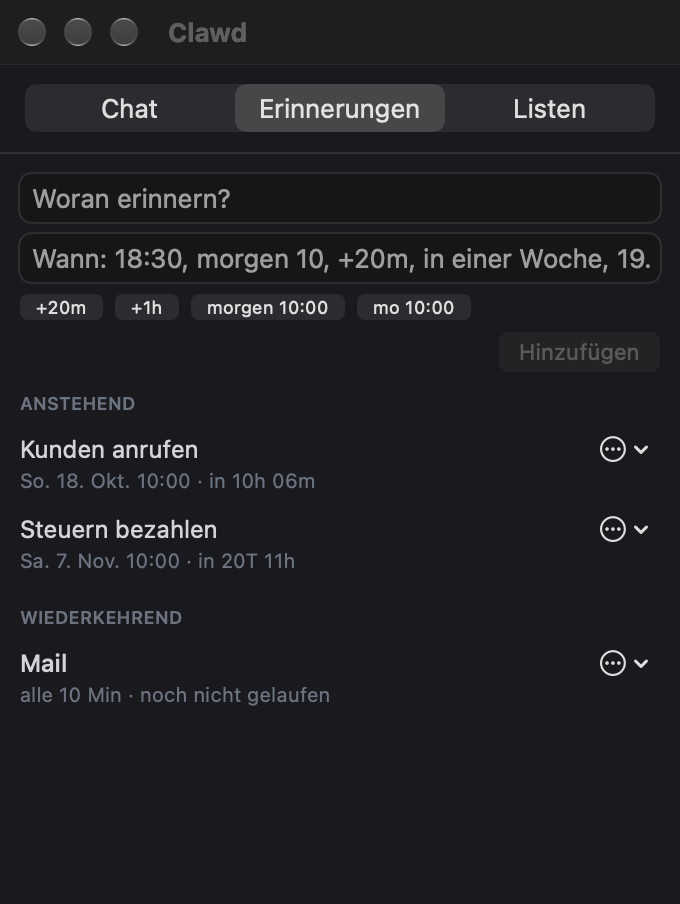
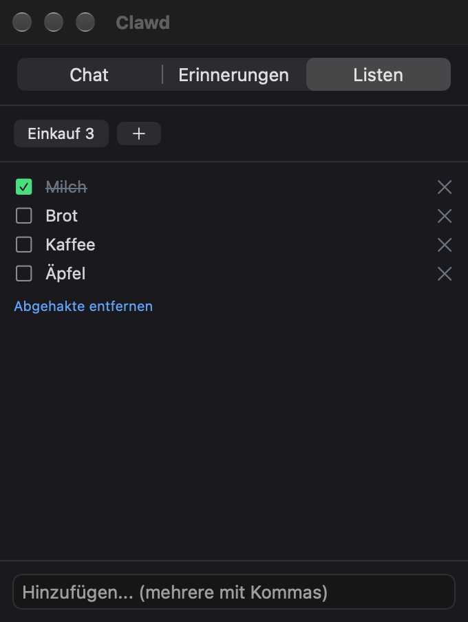
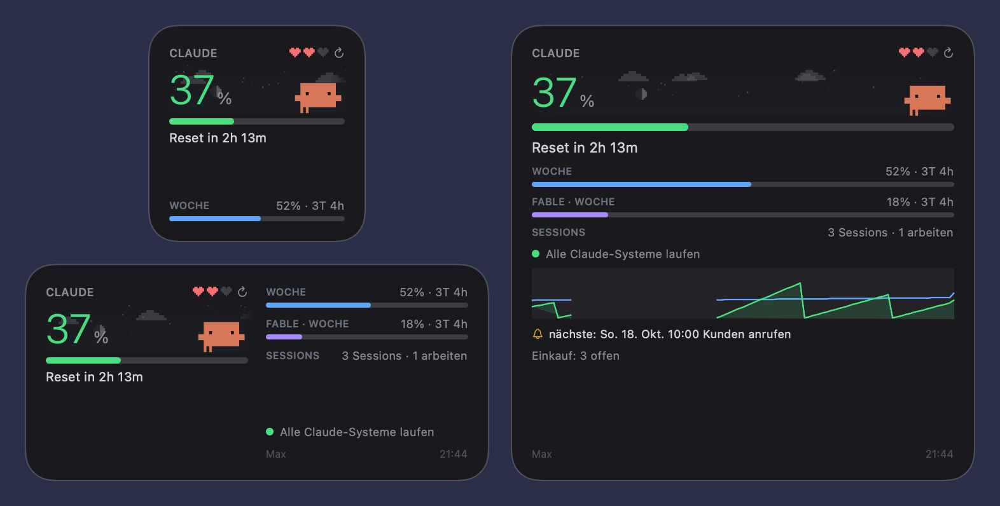
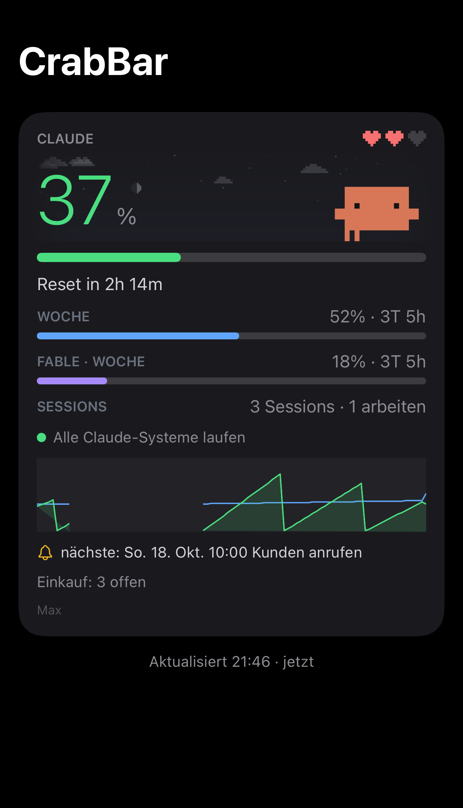

<p align="center"></p>

# CrabBar

[English](README.md) · **Deutsch**

Claude-Limits in der Mac-Menüleiste, bewacht von der Pixelkrabbe Clawd. Mit Widgets für Mac und iPhone.

Nativer macOS-Nachbau von [clawd-usage-winwidget](https://github.com/Enhed/clawd-usage-winwidget) von Venger Sergey. Das Original ist ein PowerShell/WPF-Widget für Windows. Dieser Port ist eine Menüleisten-App mit WidgetKit-Widgets, komplett neu in Swift geschrieben und im Verhalten eng am Original in seiner Version 1.6.0, dazu einige Funktionen aus späteren Versionen.

Die App zeigt die Claude-Plan-Limits wie `/usage`. Dazu kommt Clawd, die Pixelkrabbe vom Startbildschirm von Claude Code, auf einem Himmel mit echtem Sonnenstand und Wetter. Außerdem gibt es die laufenden Claude-Code-Sessions, den Status von status.claude.com und Clawds Assistenten: Chat, Erinnerungen, Listen, wiederkehrende Aufgaben und Tipps für einen aufgeräumten Mac.

> Inoffizielles Projekt. Keine Verbindung zu Anthropic, weder unterstützt noch empfohlen. Claude, Claude Code und die Figur Clawd gehören Anthropic. Die MIT-Lizenz gilt nur für diesen Code, nicht für Namen oder Grafiken von Anthropic.

<p align="center"></p>

## Funktionen

- **Limits:** aktuelle 5-Stunden-Session, Woche (alle Modelle) und die eigene Fable-Woche, jeweils mit Countdown bis zum Reset. Grün unter 60 %, gelb ab 60 %, rot ab 85 %.
- **Menüleisten-Icon:** ein Kreis in der Level-Farbe mit dem Session-Prozentwert. Linksklick öffnet die Karte, Rechtsklick das Menü. Die Karte kann auch frei auf dem Schreibtisch schweben.
- **Clawd:** alle Animationen des Originals, Frame für Frame:
  - Er schläft im Sand, wenn nichts läuft.
  - Er spaziert, wenn Sessions ruhen, und rennt, während eine arbeitet.
  - Er hüpft mit „?“, wenn eine Session auf dich wartet.
  - Er legt sich hin, wenn das Limit aufgebraucht ist, und feiert einen Reset mit Konfetti.
  - Drei Herzen zeigen, wie viel vom Session-Limit übrig ist. Ein Rechtsklick öffnet das Entwicklermenü mit einer Demo aller Animationen.
- **Himmel:** Farbverlauf nach den echten Sonnenzeiten, Sonne und Mond (in der echten Phase) auf einem Bogen, Sterne, Wolken, Nebel, Regen, Schnee und Blitze nach dem aktuellen Wetter.
- **Details:** Anfragen und die „What's contributing“-Zeilen aus `/usage` für 24 Stunden und 7 Tage, ein 7-Tage-Verlauf beider Limits und die Top-Projekte, geschätzt aus den lokalen Transkripten.
- **Widgets:** klein, mittel und groß, mit Aktualisieren-Button.
- **iPhone:** eine eigene App mit denselben Widgets für den Home-Bildschirm, dazu Ring und Rechteck für den Sperrbildschirm. Die Daten kommen über die private CloudKit-Datenbank vom Mac.
- **Clawds Panel:**
  - **Chat** mit Clawd (ein headless `claude -p` in seinem eigenen Ordner). Vorgeschlagene Skripte laufen erst nach Klick auf „Ausführen“.
  - **Erinnerungen**, auch wiederkehrende (täglich, wöchentlich, monatlich, jährlich), mit Karte und Später-Knöpfen, wenn sie fällig sind.
  - **Listen.**
  - **Wiederkehrende Aufgaben** im Hintergrund, in festen Abständen oder zu festen Uhrzeiten, die sich nur melden, wenn es etwas zu sagen gibt.
  - **Mac-Tipps:** wenig freier Speicher, Caches und anderer Datenmüll, neue Anmeldeobjekte, lange nicht geöffnete Apps, wartende Updates, RAM- und CPU-Fresser.
- **Remote Control** (optional): hält Clawds eigene Claude-Code-Session am Laufen, damit du ihn vom Handy aus erreichst.
- Deutsch und Englisch.

## Screenshots

Alle Bilder stammen aus dem Demo-Modus mit erfundenen Daten (siehe [Bauen](#bauen)).

| Die Karte | Mit Details |
|---|---|
|  |  |

| Clawds Chat | Erinnerungen und Aufgaben | Listen |
|---|---|---|
|  |  |  |

**Widgets auf dem Mac**



**iPhone-App** (die iPhone-Widgets nutzen dieselben Layouts)



## Voraussetzungen

- macOS 15 oder neuer, Xcode 26 oder neuer; die iPhone-App braucht iOS 18 oder neuer
- [XcodeGen](https://github.com/yonaskolb/XcodeGen): `brew install xcodegen`
- Claude Code mit `/usage` im Print-Modus (etwa ab 2.1.2xx). Die App nimmt die neueste `claude`-Version, die sie findet, auch die aus der Claude-Desktop-App. In den Einstellungen lässt sich ein fester Pfad setzen.
- Ein Apple-Entwicklerteam zum Signieren. Für den lokalen Betrieb reicht ein kostenloses persönliches Team. Der Abgleich mit dem iPhone braucht iCloud und Push und damit eine bezahlte Mitgliedschaft im Apple Developer Program. Mit einem persönlichen Team bleibt in `Config/Local.xcconfig` `CLAWD_ICLOUD = NO` stehen (so steht es in der Vorlage), die Mac-App läuft dann ohne Abgleich.

## Bauen

1. Repo klonen, Signier-Vorlage kopieren und eigene Team-ID sowie ein eigenes Bundle-ID-Präfix eintragen:

   ```bash
   git clone https://github.com/Breitec/crabbar.git && cd crabbar
   cp Config/Local.xcconfig.example Config/Local.xcconfig
   ```

   Ohne `Config/Local.xcconfig` signiert Xcode die App nur für den lokalen Betrieb. Zum Ausprobieren der Karte reicht das, die Widgets bleiben aber womöglich leer, weil ihre App Group nach deinem Team benannt ist.

2. Xcode-Projekt erzeugen und bauen:

   ```bash
   xcodegen generate
   xcodebuild -project CrabBar.xcodeproj -scheme CrabBar -configuration Release -destination 'generic/platform=macOS' -derivedDataPath build -allowProvisioningUpdates build
   ```

3. `build/Build/Products/Release/CrabBar.app` nach `/Applications` kopieren und starten. Die Widgets fügst du per Rechtsklick auf den Schreibtisch → „Widgets bearbeiten“ hinzu.

   Beim ersten Bauen mit iCloud legt `-allowProvisioningUpdates` ein Mac-Development-Profil an und registriert im Entwicklerkonto den iCloud-Container. Container lassen sich später nicht mehr löschen. In Xcode muss dafür unter Settings → Accounts der Apple Account des Teams angemeldet sein.

4. iPhone-App, im Simulator:

   ```bash
   xcodebuild -project CrabBar.xcodeproj -scheme CrabBariOS -destination 'generic/platform=iOS Simulator' -derivedDataPath build build
   ```

   Auf dem eigenen iPhone das Schema `CrabBariOS` in Xcode ausführen. Die automatische Signierung meldet dabei die App-IDs mit iCloud, Push und der App Group an.

Tests des gemeinsamen Core-Pakets (Parser, Regeln, Dateiformate, Maskottchen):

```bash
cd Packages/ClawdCore && swift test
```

Zum Prüfen der Oberfläche ohne Bildschirmaufnahme-Rechte schreibt `CrabBar.app/Contents/MacOS/CrabBar --render <ordner>` nach etwa 40 Sekunden PNGs von Karte, Panel und Einstellungen.
Weitere Schalter:

- `--demo`: erfundene, feste Daten (Projekte wie „my-app“, neutrale Statistiken, `you@example.com`, eine Beispiel-Unterhaltung, Erinnerungen und eine Einkaufsliste). Die App liest und schreibt dabei weder deine Dateien noch die Widget-Daten noch iCloud, Clawds Ordner ist ein temporärer. Zusammen mit `--render` zeichnet sie auch die Widgets. Die Bilder in dieser README stammen daher.
- `--gif`: schreibt zusammen mit `--render` zusätzlich `clawd.gif`, die Animation oben in dieser README.
- `--lang en|de`: die Sprache der Bilder. `--anonymize`: ersetzt das echte Konto in der Fußzeile.

```bash
open -n build/Build/Products/Release/CrabBar.app --args --demo --render ~/Desktop/crabbar-bilder --lang de --gif
```

Auch die iPhone-App kennt `--demo`. Dazu einen Simulator starten (`open -a Simulator`), den Build aus Schritt 4 installieren und starten:

```bash
xcrun simctl install booted build/Build/Products/Debug-iphonesimulator/CrabBar.app
xcrun simctl launch booted <BUNDLE_ID_PREFIX>.CrabBariOS --demo
```

## Aktualisieren

CrabBar fragt einmal pro Stunde bei GitHub, ob es ein neueres Release gibt. Dann steht in den Details „CrabBar 1.1.0 verfügbar“ statt der Version, und das Rechtsklick-Menü bekommt einen Eintrag. Beide öffnen die Release-Seite. Heruntergeladen oder installiert wird nichts. Zum Aktualisieren den neuen Code holen, das Projekt neu erzeugen (nur so kommen neue Quelldateien hinein) und bauen:

```bash
git pull
xcodegen generate
xcodebuild -project CrabBar.xcodeproj -scheme CrabBar -configuration Release -destination 'generic/platform=macOS' -derivedDataPath build -allowProvisioningUpdates build
```

Danach CrabBar beenden, die neue `build/Build/Products/Release/CrabBar.app` wie in Schritt 3 nach `/Applications` kopieren und starten.

Abschalten lässt sich die Prüfung unter Einstellungen → Daten → CrabBar oder mit `"updateCheck": false`. Die Version der App kommt aus `MARKETING_VERSION` in `project.yml`. Gefunden wird ein GitHub-Release mit Tag wie `v1.1.0`, das weder Entwurf noch Vorabversion ist.

## Bedienung

### Menüleisten-Icon

Ein Linksklick auf das Icon öffnet die Karte in einem Popover. Ein zweiter Klick auf das Icon oder ein Klick daneben schließt es wieder.

Ein Rechtsklick öffnet das Menü:

- Die erste Zeile zeigt, welche Claude-Code-Version die App nutzt. Darunter erscheint „CrabBar 1.1.0 verfügbar…“, wenn es auf GitHub ein neueres Release gibt, und öffnet dessen Seite.
- „Schwebendes Fenster“ zeigt die Karte als eigenes Fenster an oder blendet es aus (siehe unten).
- „Clawds Panel öffnen“ öffnet Chat, Erinnerungen und Listen.
- „Jetzt aktualisieren“ fragt `/usage`, status.claude.com und das Konto sofort ab, statt auf das nächste Intervall zu warten.
- „Größer“ und „Kleiner“ ändern die Größe der Karte in Schritten von 0,1.
- „Mac jetzt durchsehen“ startet die Prüfung für die Mac-Tipps und öffnet den Chat in Clawds Panel.
- „Clawds Session mit Remote Control“ schaltet Clawds eigene Claude-Code-Session ein oder aus. „Clawds Session neu starten“ beendet sie, und kurz darauf startet die App sie wieder.
- „Sprache“ wechselt zwischen System, Deutsch und English.
- „Einstellungen…“, „config.json öffnen“ und „Beenden“.

Der Tooltip des Icons zeigt den Session-Wert mit der Zeit bis zum Reset, dazu die Werte für Woche und Fable. Mit „Tooltip mit Reset-Uhrzeiten“ (Einstellungen → Allgemein) stehen dort statt des Countdowns die Uhrzeiten der Resets. Findet die App `claude` nicht oder ist die Version zu alt, steht stattdessen die Fehlermeldung im Tooltip.

### Die Karte

- Rechts neben dem Titel „CLAUDE USAGE“ stehen im Kopf das Symbol für Clawds Panel, Clawds Herzen und drei Knöpfe: ▾/▴ („Details“) klappt die Details auf und zu, – („Ausblenden“) schließt das Popover, ✕ („Beenden“) beendet die App.
- Das Symbol zeigt, was wartet, und öffnet per Klick Clawds Panel: eine Glocke für eine fällige Erinnerung, eine blaue Sprechblase, wenn Clawd geantwortet hat, eine Glühbirne mit der Zahl der Mac-Tipps, sonst eine graue Sprechblase.
- Die Herzen zeigen, wie viel vom Session-Limit übrig ist. Ihr Tooltip nennt den Wert in Prozent.
- Ein Rechtsklick auf den Kopf der Karte öffnet dasselbe Menü wie das Menüleisten-Icon.
- Der Tooltip der Zeile „SESSIONS“ listet die laufenden Sessions mit ihren Ordnern. Ein Klick auf die Statuszeile öffnet status.claude.com.
- In den Details zeigt die Claude-Code-Zeile, ob es eine neuere Version gibt. Steht dort „… verfügbar · was ist neu?“, listet der Tooltip die Änderungen, und ein Klick startet `claude update` in einem Terminal-Fenster. Sonst öffnet ein Klick den Changelog auf GitHub.
- Daneben wird aus „CrabBar v1.0.0“ ein „CrabBar 1.1.0 verfügbar“, wenn es ein neueres Release gibt. Der Tooltip listet die Release-Notizen, ein Klick öffnet die Release-Seite.
- Die Fußzeile zeigt Plan und Konto sowie die Uhrzeit der letzten `/usage`-Antwort. Ist diese älter als drei Intervalle plus 30 Sekunden (3,5 Minuten bei den voreingestellten 60 s), steht „veraltet“ davor.

### Clawd

- Steht der Mauszeiger über der Karte, schaut Clawd in seine Richtung. Ruhen die Sessions 10 Minuten lang, döst er ein. Der Mauszeiger über der Karte hält ihn wach.
- Ein Klick auf Clawd spielt eine zufällige Animation ab, und über ihm steigt ein kleines Herz auf. Liegt er am Limit flach, entweicht stattdessen seine Seele. Schläft er im Sand vergraben, lugt er heraus.
- Er winkt, wenn er im Chat geantwortet oder eine Aufgabe etwas gemeldet hat, während das Panel zu war. Bei einer fälligen Erinnerung hüpft er.
- Ein Rechtsklick auf Clawd oder den Himmel öffnet das Entwicklermenü. „Auto (Live-Daten)“ kehrt zu den echten Daten zurück, „Alles nacheinander zeigen“ spielt alle Zustände und Animationen ab. Über „Zustand“, „Animation“, „Herzen“ und „Himmel“ lässt sich ein einzelner Fall erzwingen, „Schwitzt nahe am Limit“ schaltet das Schwitzen ein, und „Herzverlust abspielen“ (unter „Herzen“) zeigt, wie die Herzen weniger werden.
- Clawd und der Himmel bewegen sich nur, solange das Popover oder das schwebende Fenster zu sehen ist.

### Schwebendes Fenster

- „Schwebendes Fenster“ im Menü oder Einstellungen → Allgemein → Schwebendes Fenster → „Anzeigen“ legt die Karte als randloses Fenster auf den Schreibtisch. Es erscheint auf allen Spaces.
- Zum Verschieben die Karte ziehen. Die Position landet in `config.json` (`left`, `top`).
- „Immer im Vordergrund“ und „Deckkraft“ stehen im selben Abschnitt der Einstellungen. Die Größe stellen „Größer“ und „Kleiner“ oder der Regler „Größe“ ein.
- Im schwebenden Fenster schließt – („Ausblenden“) das Fenster. ✕ beendet weiterhin die App.

### Clawds Panel

Das Panel öffnet sich über das Symbol in der Karte, über „Clawds Panel öffnen“ im Menü oder mit `open crabbar://panel`. Es hat drei Reiter.

**Chat**

- Nachricht schreiben und Return drücken. Jede Nachricht ist ein Aufruf von `claude -p` in Clawds Ordner mit dem Chat-Modell (voreingestellt `sonnet`). Während Clawd antwortet, steht dort „Clawd denkt nach · N s“ mit einem Stopp-Knopf. Nach dem Timeout (voreingestellt 300 s) bricht die App den Aufruf ab.
- Clawd darf nur lesen. Änderungen schlägt er als Skript-Karte vor, mit „Ausführen“, „Ändern“ und „Nicht jetzt“. „Ausführen“ startet das Skript mit zsh in Clawds Ordner. Es darf bis zu 24 Stunden laufen, der Stopp-Knopf beendet es früher. Danach bekommt Clawd die Ausgabe und sagt, was dabei herauskam. Eine neue Nachricht von dir ersetzt Skript-Karten, die noch offen sind.
- „AUTO“ oben (gelb, wenn an; derselbe Schalter wie „Auto: Skripte ohne Klick ausführen“ in den Einstellungen) startet die Skripte des Chats ohne Klick. Ein Skript, das eine wiederkehrende Aufgabe vorschlägt, wartet weiter auf den Klick. Nach drei Skripten hintereinander wartet das nächste wieder auf einen Klick. Deine nächste Nachricht setzt den Zähler zurück.
- „+“ beginnt ein neues Gespräch.
- Über dem Chat stehen unter „TIPPS“ die Mac-Tipps. Ein Link öffnet die passende Stelle (zum Beispiel „Speicher-Einstellungen“), „Erledigen“ gibt den Tipp an Clawd weiter, mit „Ändern“ sagst du, was passieren soll, × blendet ihn aus und ↻ („Nochmal prüfen“) prüft neu.
- Nennt eine wiederkehrende Aufgabe Werkzeuge, die über Lesen hinausgehen (einen MCP-Server, einen Befehl, eine Website), oder wurde einem Lauf ein Werkzeug verweigert, listet eine Karte „Aufgabe … erlauben:“ diese Werkzeuge auf. Ein verweigerter Befehl oder eine verweigerte Website bekommt so eine Karte, ein MCP-Werkzeug nur, wenn die Werkzeuge der Aufgabe schon einen MCP-Server nennen: Ohne einen startet eine Aufgabe keinen. „Erlauben“ gibt sie für diese Aufgabe frei und startet sie erneut, „Nicht jetzt“ lässt alles, wie es ist. Die Karte zeigt den ganzen Aufgabentext, unsichtbare Zeichen als [U+…], und wann und mit welchem Modell die Aufgabe läuft. Ändert sich die Aufgabendatei später (Text, Werkzeuge, Modell oder Zeiten), kommt die Karte erneut. Bis du erlaubst, steht in der Zeile der Aufgabe, dass sie auf deine Freigabe wartet, und „Jetzt ausführen“ zeigt die Karte noch einmal. Die freigegebenen Werkzeuge von Aufgaben, die nicht pausiert sind, darf auch der Chat nutzen. Ist ein MCP-Server als Ganzes freigegeben, laufen nur seine lesenden Aufrufe sofort. Für andere Aufrufe zeigt Clawd eine Karte „Clawd möchte:“, und sie laufen erst nach einem Klick auf „Ausführen“. Eine neue Nachricht ersetzt so eine Karte, solange sie offen ist. Mit AUTO laufen diese Aufrufe sofort.
- Nachrichten aus Clawds Remote-Control-Session erscheinen im selben Chat, markiert mit „Remote Control“.

**Erinnerungen**

- Text und Zeitpunkt eingeben, dann „Hinzufügen“. Das Zeitfeld versteht zum Beispiel `18:30`, `morgen 10`, `+20m`, `in einer Woche` und `19.10 14:00`, die Knöpfe darunter füllen es aus. Was das Feld nicht versteht, rechnet Clawd beim Speichern mit dem schnellen Modell (voreingestellt `haiku`) aus. Beginnt die Zeitangabe mit „jeden“, „täglich“ oder Ähnlichem, geht sie an den Chat, und Clawd legt eine wiederkehrende Erinnerung an, oder eine wiederkehrende Aufgabe, wenn jedes Mal etwas zu tun ist.
- „ANSTEHEND“ listet die geplanten Erinnerungen. ↻ markiert eine wiederkehrende und sagt, wie oft sie kommt. Das ⋯-Menü bietet „Ändern“, „+1 Stunde“ und „Löschen“. Eine wiederkehrende Erinnerung bleibt beim Ändern oder Verschieben wiederkehrend, ab ihrem neuen Zeitpunkt.
- „WIEDERKEHREND“ listet die Aufgaben aus `~/Clawd/tasks` mit Intervall oder Uhrzeiten und Zustand. Das ⋯-Menü bietet „Jetzt ausführen“, „Pausieren“ oder „Fortsetzen“, „Öffnen“ (die Markdown-Datei) und „Löschen“. Ein Klick auf eine Aufgabe zeigt ihre letzten Berichte. Aufgaben warten, solange Session- oder Wochenwert bei oder über „Aufgaben pausieren ab“ liegt (voreingestellt 80 %).
- „ZULETZT“ zeigt abgelaufene Erinnerungen, jeweils mit „nochmal“.
- Ist eine Erinnerung fällig, erscheint unten rechts eine Karte mit Ton. „+15m“, „+1h“, „+3h“ und „morgen 9:00“ verschieben sie, „…“ öffnet diesen Reiter mit dem Text, „Erledigt“ schließt die Karte. Die Erinnerung steht außerdem im Chat.

**Listen**

- Jede Liste hat einen Knopf mit der Zahl ihrer offenen Einträge. „+“ legt eine neue Liste an (Esc bricht ab). Hat Clawds Ordner noch keinen Ordner `lists`, legt die App ihn mit der Liste „Einkauf“ an.
- Ein Klick auf einen Eintrag hakt ihn ab, × entfernt ihn. „Abgehakte entfernen“ räumt die abgehakten Einträge weg. Bei einer leeren Liste erscheint „Liste löschen“.
- Das Feld unten fügt Einträge hinzu, mehrere auf einmal mit Kommas getrennt.

### Clawds Remote-Control-Session

Ist „Clawds Session mit Remote Control“ an, hält die App ein interaktives `claude` in Clawds Ordner am Laufen, mit Remote Control unter dem Namen aus „Sessionname“ (Einstellungen → Clawd, voreingestellt `crabbar`). Beim ersten Mal, solange Claude Code dem Ordner noch nicht vertraut, öffnet sich die Session im Terminal, damit du die Vertrauensfrage beantworten kannst. Danach läuft sie unsichtbar. Wenn du CrabBar beendest, endet auch die unsichtbare Session.

### Widgets

- Rechtsklick auf den Schreibtisch → „Widgets bearbeiten“, nach CrabBar suchen und klein, mittel oder groß wählen.
- Klein zeigt die Session mit Clawd und Himmel, den Reset und die Woche. Mittel zeigt zusätzlich Fable, Sessions, Status, Plan und Uhrzeit. Groß ergänzt den 24-Stunden-Verlauf, die nächste Erinnerung und offene Listeneinträge.
- ↻ im Widget bittet die laufende App, sofort `/usage` abzufragen, und lädt das Widget etwa 4 Sekunden später neu. Läuft CrabBar nicht, bringt der Knopf nichts Neues.
- Ein Klick auf eine andere Stelle des Widgets öffnet die Karte und startet CrabBar, falls nötig.
- Das Widget zeigt den letzten Schnappschuss der App mit einem Standbild von Clawd. Änderungen an dem, was es groß zeigt (Prozentwerte, Resets, Clawds Zustand, Status, nächste Erinnerung), kommen höchstens einmal pro Minute an, kleinere Änderungen warten bis zu 5 Minuten. Läuft die App nicht mehr, markiert das Widget die Zahlen nach etwa 3,5 Minuten als „veraltet“.
- In Kurzbefehlen und Spotlight gibt es die Aktion **Refresh Claude usage**. Sie lässt die App sofort `/usage` abfragen.

### Einstellungen und config.json

- „Einstellungen…“ öffnet ein Fenster mit drei Seiten. „Allgemein“: Sprache, „Bei Anmeldung starten“, Größe, Menüleisten-Icon, schwebendes Fenster, was die Karte zeigt, und die Farbschwellen. „Daten“: Ort für den Himmel, Intervalle, der iCloud-Upload fürs iPhone, die Update-Prüfung und der Pfad zu `claude`. „Clawd“: Clawds Ordner, Modelle, Timeout, Auto, wiederkehrende Aufgaben, Remote Control und Mac-Tipps.
- Textfelder werden mit Return gespeichert oder wenn du das Feld verlässt.
- Bis auf „Bei Anmeldung starten“, das macOS selbst verwaltet, stehen alle Einstellungen in `~/Library/Application Support/CrabBar/config.json`. Die App prüft die Datei bei jedem Tick (voreingestellt alle 10 Sekunden, „Tick“ unter Daten → Intervalle) und übernimmt Änderungen im laufenden Betrieb. Schlüssel, die sie nicht kennt, bleiben beim Speichern erhalten.
- Die Datei enthält die Schlüssel des Originals 1.6.0 ohne die nur für Windows und ohne `clawdSessionHidden` (Clawds Session läuft hier immer im Hintergrund), dazu einige für macOS: `floating`, `menuBarPercent`, `weatherUseLocation`, `weatherIPLookup`, `claudePath`, `iCloudSync` und `updateCheck`. Die meisten Schlüssel gibt es auch im Einstellungsfenster.
- Ordner von Claude Code: CrabBar liest `~/.claude` (Sessions, Projekte, Transkripte, `settings.json` für den Update-Kanal) und `~/.claude.json` (ob Claude Code Clawds Ordner vertraut). Steht in der Umgebungsvariable `CLAUDE_CONFIG_DIR` ein absoluter Pfad (oder einer, der mit `~/` beginnt), liest die App stattdessen diesen Ordner und die `.claude.json` darin, wie Claude Code selbst. Jeder andere Wert gilt als nicht gesetzt. Eine App, die aus dem Finder oder bei der Anmeldung startet, sieht keine Shell-Variablen. Deshalb holt CrabBar `CLAUDE_CONFIG_DIR` beim Start zusammen mit `PATH` aus deiner Login-Shell und gibt die Variable an die `claude`-Prozesse weiter, die es startet. Mit zsh (Standard auf macOS) liest eine Login-Shell `~/.zprofile` und `~/.zshenv`, nicht `~/.zshrc`. Die Variable gehört also in eine dieser beiden Dateien, mit bash in `~/.bash_profile`. Nach einer Änderung CrabBar beenden und neu starten.

### iPhone

- Das iPhone bekommt seine Daten nur vom Mac. CrabBar muss auf dem Mac laufen und mit iCloud gebaut sein (`CLAWD_ICLOUD = YES`), und „Über iCloud ans iPhone senden“ muss an sein (Einstellungen → Daten → iPhone, voreingestellt an). Beide Geräte brauchen denselben Apple Account.
- Die App zeigt den Inhalt des großen Widgets als Karte: Session, Clawd, Himmel, Reset, Woche, Fable, Sessions, Status, 24-Stunden-Verlauf, nächste Erinnerung, offene Listeneinträge und Plan. Herunterziehen holt den neuesten Datensatz. Das passiert auch jedes Mal, wenn die App in den Vordergrund kommt.
- Die Widgets für den Home-Bildschirm (klein, mittel, groß) sehen aus wie die auf dem Mac. Für den Sperrbildschirm gibt es einen Ring mit dem Session-Wert und ein Rechteck mit Clawd, Session, Reset und Woche. ↻ im Widget auf dem Home-Bildschirm holt den neuesten Datensatz aus iCloud, eine `/usage`-Abfrage auf dem Mac kann es nicht auslösen.
- Die Sprache richtet sich nach der Einstellung auf dem Mac (bei „System“ nach der des iPhones).
- Nach etwa 28 Minuten ohne neue Daten zeigt die App „Mac-App muss laufen“ und „Seit … keine neuen Daten vom Mac.“ Die Widgets auf dem Home-Bildschirm setzen „veraltet“ in Gelb vor die Reset-Zeile oder die Uhrzeit, das Rechteck auf dem Sperrbildschirm zeigt ebenfalls „veraltet“, und der Ring wird grau und blass.

## Fehlerbehebung

### „Claude Code (claude) wurde nicht gefunden“

Die App sucht `claude` nicht über den `PATH` der Shell, sondern an festen Orten: `~/.local/bin`, `/opt/homebrew/bin`, `/usr/local/bin`, `~/.claude/local` (und `local` in `CLAUDE_CONFIG_DIR`), `~/.npm-global/bin`, `~/.bun/bin`, `~/.local/share/claude/versions/` und die Kopie in der Claude-Desktop-App. Claude Code mit dem Befehl aus der Meldung installieren oder den Pfad unter Einstellungen → Daten → „Pfad zu claude“ eintragen und „Neu suchen“ klicken. Die Zeile unter dem Feld zeigt, welches `claude` die App nutzt und in welcher Version. Außerdem sucht die App einmal pro Stunde von selbst neu.

### „Diese Claude-Code-Version kennt /usage noch nicht“

`claude -p /usage` hat mit „/usage isn't available in this environment“ geantwortet. Das installierte Claude Code ist zu alt für `/usage` im Print-Modus. Abhilfe: `claude update` ausführen oder in den Details auf die Versionszeile klicken, wenn sie ein Update anbietet. Sind mehrere Kopien installiert, nimmt die App die neueste. Ein fester „Pfad zu claude“ hat aber Vorrang. Zeigt er auf eine alte Kopie, das Feld leeren.

### „nicht angemeldet: claude /login“

`claude auth status` meldet, dass niemand angemeldet ist. `claude` im Terminal starten und mit `/login` anmelden.

### Sessions werden nicht gezählt

CrabBar liest die Liste laufender Sessions, die Claude Code unter `~/.claude/sessions/<pid>.json` führt (oder unter `sessions` in `CLAUDE_CONFIG_DIR`, siehe [Einstellungen und config.json](#einstellungen-und-configjson)). Eine Datei zählt nur, solange ihr Prozess lebt und zu der Zeit gestartet wurde, die in der Datei steht (±5 Sekunden). Nicht gezählt werden Prozesse, die CrabBar selbst startet (Chat, Aufgaben, `/usage`), und Clawds eigene Remote-Control-Session, solange sie ruht. Prüfen lässt sich das mit `ls "${CLAUDE_CONFIG_DIR:-$HOME/.claude}"/sessions`, während eine Session läuft. Bleibt der Ordner leer, schreibt dieses Claude Code die Liste nicht. Dann `claude update` ausführen. Außerdem lässt sich die Zeile „SESSIONS“ unter Einstellungen → Allgemein → Anzeige → „Sessions“ ausschalten.

### Widgets fehlen in der Galerie

macOS bietet nur Widgets von Apps an, die es kennt. `CrabBar.app` nach `/Applications` kopieren, einmal von dort starten und danach „Widgets bearbeiten“ erneut öffnen. Zeigt ein Widget „CrabBar auf dem Mac öffnen“, hat es noch keinen Schnappschuss. Es füllt sich, sobald die App läuft.

### Signieren scheitert mit persönlichem Team

Ein kostenloses persönliches Team kann iCloud und Push nicht signieren. Xcode meldet dann „Personal development teams … do not support the iCloud capability“. Entweder in `Config/Local.xcconfig` `CLAWD_ICLOUD = NO` setzen oder dem bezahlten Apple Developer Program beitreten und `CLAWD_ICLOUD = YES` setzen. Mit `NO` entsteht die Mac-App ohne Abgleich mit dem iPhone. Die iPhone-App braucht immer iCloud und damit das bezahlte Programm.

### „No Accounts“

`-allowProvisioningUpdates` braucht den Apple Account des Teams in Xcode. Unter Xcode → Settings → Accounts hinzufügen und neu bauen.

### „Device … isn't registered in your developer account“

Ein signierter Mac-Build mit iCloud und ein Build für das eigene iPhone brauchen beide das Gerät in der Geräteliste des Teams. Mit `-allowProvisioningDeviceRegistration` im Build-Befehl registriert sich der Mac:

```bash
xcodebuild -project CrabBar.xcodeproj -scheme CrabBar -configuration Release -destination 'generic/platform=macOS' -derivedDataPath build -allowProvisioningUpdates -allowProvisioningDeviceRegistration build
```

Für das iPhone gilt dasselbe. Führst du das Schema `CrabBariOS` in Xcode auf dem angeschlossenen iPhone aus, registriert die automatische Signierung das Gerät. Mit `xcodebuild` kommt `-allowProvisioningDeviceRegistration` dazu:

```bash
xcodebuild -project CrabBar.xcodeproj -scheme CrabBariOS -destination 'platform=iOS,name=<dein iPhone>' -derivedDataPath build -allowProvisioningUpdates -allowProvisioningDeviceRegistration build
```

### „Bad Container“ direkt nach dem ersten iCloud-Build

Der erste Build registriert den iCloud-Container. Danach kann CloudKit einige Minuten lang mit „Bad Container“ antworten. Einstellungen → Daten → iPhone zeigt dann „iCloud: …“ in Orange. Meist schickt CloudKit dabei einen Hinweis, wann es erneut versuchen soll. Die App versucht es dann nach etwa einer Minute wieder, der erste Upload klappt also wenige Minuten später. Ohne Hinweis wartet sie 30 Minuten. Schneller geht es, wenn du CrabBar beendest und neu startest. Sobald ein Upload klappt, steht im Log `icloud: snapshot uploaded`.

### „Invalid bundle ID for container“ auf dem iPhone

Der erste Build für dein iPhone legt die App-IDs der iPhone-App und ihres Widgets an und verknüpft sie mit dem iCloud-Container. Einige Minuten lang kennt CloudKit diese Verknüpfung danach womöglich noch nicht, und die iPhone-App zeigt „iCloud: … Invalid bundle ID for container“ in Orange. Ein paar Minuten warten, dann in der App nach unten ziehen, um neu zu laden. Kommt die Meldung nach etwa 15 Minuten immer noch, auf developer.apple.com unter Certificates, Identifiers & Profiles → Identifiers prüfen, ob bei `<BUNDLE_ID_PREFIX>.CrabBariOS` und `<BUNDLE_ID_PREFIX>.CrabBariOS.Widget` unter iCloud der Container `iCloud.<BUNDLE_ID_PREFIX>.crabbar` angehakt ist.

### iPhone zeigt keine oder alte Daten

- Auf dem Mac sollte unter Einstellungen → Daten → iPhone „Zuletzt an iCloud übertragen um …“ stehen. „Diesem Build fehlt die iCloud-Berechtigung.“ heißt, die Mac-App wurde mit `CLAWD_ICLOUD = NO` gebaut. Ein Fehler erscheint als „iCloud: …“ in Orange.
- Nach dem Start lädt die Mac-App erst hoch, wenn die ersten `/usage`-Werte (oder eine Fehlermeldung) da sind. So überschreibt kein leerer Stand die letzten Zahlen.
- Mac und iPhone müssen mit demselben Apple Account bei iCloud angemeldet sein. Ist das iPhone nicht angemeldet, meldet die App „Bei iCloud anmelden, damit die Daten vom Mac ankommen.“ Bei verschiedenen Accounts bleibt es bei „Noch keine Daten vom Mac“.
- Aus Xcode gebaute Apps nutzen die CloudKit-Umgebung „Development“, eine iPhone-App aus TestFlight liest „Production“ (siehe [iPhone und iCloud](#iphone-und-icloud)).
- Silent Pushes kommen nicht immer an. Die App öffnen oder darin herunterziehen holt den Datensatz. Die Widgets fragen außerdem etwa alle 15 Minuten selbst bei iCloud nach.
- Nach etwa 28 Minuten ohne Upload gelten die Zahlen als veraltet. Ein Mac im Ruhezustand oder ohne laufendes CrabBar lädt nichts hoch.

### Logdatei

Die App schreibt Probleme nach `~/Library/Application Support/CrabBar/widget-error.log`, je eine Zeile mit ISO-Zeitstempel: fehlgeschlagene `/usage`-Abfragen (`usage: exit …`), iCloud-Fehler (`icloud: …`) und `icloud: snapshot uploaded` beim ersten Upload nach dem Start und immer dann, wenn das Hochladen nach einem Fehler wieder klappt.

```bash
tail -n 50 ~/Library/Application\ Support/CrabBar/widget-error.log
```

Einstellungen → Daten → iPhone zeigt die Uhrzeit des letzten erfolgreichen Uploads („Zuletzt an iCloud übertragen um …“) oder den letzten Fehler. Steht dort nichts, hat die App seit dem Start noch nichts hochgeladen.

## Deinstallation

1. „Bei Anmeldung starten“ (Einstellungen → Allgemein) und „Clawds Session mit Remote Control“ ausschalten. Hat sich die Session einmal im Terminal geöffnet, auch dieses Fenster schließen. Dann CrabBar beenden. Ein übrig gebliebenes Anmeldeobjekt lässt sich später unter Systemeinstellungen → Allgemein → Anmeldeobjekte & Erweiterungen entfernen.

2. App und Daten löschen:

   ```bash
   rm -rf /Applications/CrabBar.app
   rm -rf ~/Library/Application\ Support/CrabBar
   rm -rf ~/Library/Group\ Containers/<TEAM_ID>.<BUNDLE_ID_PREFIX>.crabbar
   rm -rf ~/Library/Containers/<BUNDLE_ID_PREFIX>.CrabBar.Widget
   rm -f "$TMPDIR"/clawd-*
   ```

   - `Application Support/CrabBar`: Einstellungen, `/usage`-Verlauf, Chat-Verlauf, der Zustand von Aufgaben, Tipps und Clawds Session, der Token-Cache für die Projekte, die Logdatei und die Prompts für Claude.
   - `Group Containers/…`: der Schnappschuss, den App und Widget teilen. Team-ID und Präfix sind die Werte aus `Config/Local.xcconfig`.
   - `Containers/….CrabBar.Widget`: der Sandbox-Container der Widget-Extension.
   - `$TMPDIR/clawd-*`: Terminal-Skripte für `claude update` und den ersten Start von Clawds Session.

   macOS fragt dabei womöglich, ob das Terminal auf Daten anderer Apps zugreifen darf.

3. Clawds Ordner `~/Clawd` (oder der unter „Clawds Ordner“ eingestellte) enthält deine Erinnerungen, Listen und Aufgaben sowie `tips.md` und `chat-log.md`. Lösch ihn nur, wenn du das alles nicht mehr brauchst: `rm -rf ~/Clawd`.

4. Claude Code legt die Transkripte des Panel-Chats und von Clawds Remote-Control-Session unter `~/.claude/projects/` ab (mit gesetztem `CLAUDE_CONFIG_DIR` unter `projects` dort), in einem Ordner, der nach dem Pfad von Clawds Ordner benannt ist:

   ```bash
   rm -rf "${CLAUDE_CONFIG_DIR:-$HOME/.claude}"/projects/"$(printf %s "$HOME/Clawd" | sed 's/[^A-Za-z0-9]/-/g')"
   ```

   Hast du die Vertrauensfrage beantwortet, merkt sich Claude Code das in `~/.claude.json` (oder in `.claude.json` in `CLAUDE_CONFIG_DIR`). Der Eintrag stört nicht.

5. iCloud: Der Container `iCloud.<BUNDLE_ID_PREFIX>.crabbar` bleibt im Entwicklerkonto, Container lassen sich nicht löschen. Sein Inhalt ist ein Datensatz (`current` in der Zone `CrabBar`) in deiner privaten Datenbank, dazu die Push-Subscription `clawd-snapshot` der iPhone-App. Zum Leeren zuerst den Upload stoppen (Schritt 2 oder `"iCloudSync": false`), denn die Mac-App legt die Zone beim nächsten Upload neu an. Dann in der CloudKit Console (icloud.developer.apple.com) den Container öffnen, die Umgebung wählen (Development für Builds aus Xcode), dich mit „Act as iCloud Account“ an der privaten Datenbank anmelden und die Zone `CrabBar` löschen. App-IDs und App Groups lassen sich unter Certificates, Identifiers & Profiles entfernen.

6. iPhone: die CrabBar-App löschen. Damit verschwinden auch ihre Widgets und die Kopie des Schnappschusses in ihrer App Group.

## Wie es funktioniert

| Was | Woher |
|---|---|
| Limits | `claude -p /usage --output-format text --no-session-persistence` alle 60 s, ohne Modellaufruf und ohne Tokens |
| Konto | `claude auth status` |
| Sessions | `~/.claude/sessions/*.json`, gezählt nur, solange der Prozess lebt und derselbe ist |
| Projekte | `~/.claude/projects/**/*.jsonl`, inkrementell gelesen |
| Status | status.claude.com |
| Versionen | downloads.claude.ai, Changelog von GitHub |
| CrabBar-Releases | api.github.com, einmal pro Stunde |
| Wetter | Open-Meteo, ersatzweise met.no; Ort aus den Einstellungen oder den macOS-Ortungsdiensten |
| iPhone | Schnappschuss, den die Mac-App in die private CloudKit-Datenbank hochlädt |

`~/.claude` steht für den Ordner aus `CLAUDE_CONFIG_DIR`, wenn die Variable gesetzt ist.

Die App läuft ohne App-Sandbox, weil sie `claude` startet und `~/.claude` liest. Deshalb ist sie auch nicht für den App Store gedacht. Die Widget-Extension ist gesandboxt und bekommt ihre Daten aus einem Schnappschuss in einer gemeinsamen App Group.

### iPhone und iCloud

Die Mac-App schreibt denselben Schnappschuss als einen Datensatz in die private Datenbank des Containers `iCloud.<BUNDLE_ID_PREFIX>.crabbar` (aus `Config/Local.xcconfig`) (Zone `CrabBar`, Datensatz `current`). Der Inhalt steht in einem verschlüsselten Feld. Hochgeladen wird höchstens alle 60 Sekunden, wenn sich etwas Sichtbares geändert hat, und sonst alle 10 Minuten als Lebenszeichen. Direkt nach dem Start wartet die App auf die ersten Werte, damit kein leerer Stand die letzten Zahlen überschreibt.

Die iPhone-App legt eine `CKDatabaseSubscription` mit Silent Push an. Kommt ein Push, holt sie den Datensatz, legt ihn in ihre App Group und lädt die Widgets neu. Bleibt der Push aus, fragt das Widget bei seiner nächsten Aktualisierung (etwa alle 15 Minuten) selbst bei CloudKit nach. Der Aktualisieren-Knopf im iPhone-Widget holt den letzten Stand aus iCloud, eine neue `/usage`-Abfrage auf dem Mac kann er nicht auslösen.

Auf dem iPhone gelten die Zahlen nach etwa 28 Minuten ohne neue Daten als veraltet (Mac-Intervall, Lebenszeichen und Widget-Takt zusammen). Die App zeigt dann „Mac-App muss laufen“.

Aus Xcode gebaute Apps nutzen die CloudKit-Umgebung „Development“. Kommt die iPhone-App über TestFlight, spricht sie mit „Production“. Dann muss die Mac-App ebenfalls nach Production schreiben (Entitlement `com.apple.developer.icloud-container-environment`), und das Schema muss vorher in der CloudKit Console nach Production übertragen werden.

| Teil | Inhalt |
|---|---|
| `Packages/ClawdCore` | Gemeinsamer Code für App und Widget: `/usage`-Parser, Formatierung, Clawds Sprites und Animationen, Himmel-Engine, Wetter, Dateiformate, Zeitparser für Erinnerungen, Widget-Schnappschuss |
| `CrabBar/` | Die Menüleisten-App |
| `CrabBarWidget/` | Die WidgetKit-Extension |
| `WidgetShared/` | Widget-Layouts, die Mac- und iPhone-Widget gemeinsam nutzen |
| `CrabBariOS/` | Die iPhone-App: Karte mit den Werten, Silent Push, Schnappschuss in der App Group |
| `CrabBariOSWidget/` | Die iPhone-Widgets für Home- und Sperrbildschirm |
| `tools/make-icon.sh` | Erzeugt das App-Icon aus Clawds Sprite-Daten |

## Datenschutz und Sicherheit

- Die App liest und speichert keine Claude-Zugangsdaten. Sie startet nur die `claude`-CLI und liest deren lokale Dateien.
- **Chat:** Claude darf nur lesen:
  - Schreib- und Bearbeitungswerkzeuge sind gesperrt.
  - Erlaubt sind nur lesende Shell-Befehle (`ls`, `df`, `du`, `ps` und ähnliche), dazu, was deine eigenen Claude-Code-Einstellungen erlauben (siehe unten).
  - Änderungen kommen als Skript, das auf deinen Klick wartet, außer „Auto“ ist eingeschaltet.
- **Wiederkehrende Aufgaben:** Braucht eine Aufgabe mehr als Lesen (einen MCP-Server, einen Befehl, eine Website), läuft sie erst, nachdem du diese Werkzeuge erlaubt hast. Die Freigabe gilt für die Aufgabe, wie sie damals war: Ändern sich Text, Werkzeuge, Modell oder Zeiten, auch wenn Claude die Datei geschrieben oder geändert hat, fragt sie erneut. Das gilt auch, wenn eine pausierte Aufgabe anders als mit „Fortsetzen“ im Panel wieder läuft. Pausieren und das Limit fragen nicht. Die Antwort einer Aufgabe kann keine Aufgaben anlegen, ändern oder löschen, und ein Skript, das sie vorschlägt, wartet auf deinen Klick, auch mit „Auto“. Einmal erlaubt, nutzt eine Aufgabe diese Werkzeuge ohne weitere Nachfrage, und was sie liest (eine Mail, eine Webseite), kann sie steuern: Erlaube einer Aufgabe nur, was sie unbeaufsichtigt tun darf. Ein ganzer MCP-Server schließt Senden und Löschen ein.
- **Claude-Code-Einstellungen:** Chat und Aufgaben laden nur deine eigenen Claude-Code-Einstellungen: `~/.claude/settings.json` und `~/.claude/CLAUDE.md` (oder die in `CLAUDE_CONFIG_DIR`), dazu aktivierte Plugins mit ihren Hooks. Sie laden nicht die Projekteinstellungen in `~/Clawd/.claude`, keine `CLAUDE.md` in `~/Clawd` und nicht das Auto-Memory von Claude Code für `~/Clawd`, denn die kann Claude oder die Remote-Control-Session schreiben. Allow-Regeln und Hooks in deinen eigenen Einstellungen gelten weiter, auch für Aufgaben: Was sie erlauben, nutzt eine Aufgabe ohne Nachfrage, halte sie also eng.
- **MCP-Server:** Chat und Aufgaben laden nur MCP-Server im User-Scope (`claude mcp add --scope user …`), die von Plugins, die in deinen eigenen Einstellungen aktiviert sind (Werkzeuge `mcp__plugin_<plugin>_<server>`), und claude.ai-Connectors. Server, die nur für `~/Clawd` eingerichtet sind (der Local-Scope, Voreinstellung von `claude mcp add` in diesem Ordner, oder `~/Clawd/.mcp.json`), werden nicht geladen. Eine Aufgabe ohne `mcp__`-Regel startet keine MCP-Server, der Chat auch nicht, solange keine aktive freigegebene Aufgabe eine hat (außer bei einem Aufruf, den du auf einer Karte „Clawd möchte“ erlaubst).
- **Was eine Aufgabe sieht:** Außer CrabBars Regeln für Aufgaben und deiner eigenen `CLAUDE.md` enthält der Prompt einer Aufgabe nur ihren Text, die Uhrzeit, Name, Zeitplan und Werkzeuge der Aufgabe, den Zeitpunkt des letzten Laufs und ihren eigenen letzten Bericht (der wiedergeben kann, was sie vorher gelesen hat), nicht den Chat, das Gespräch vom Handy oder die Berichte anderer Aufgaben. Mit ihren Lesewerkzeugen kann sie trotzdem Dateien wie `chat-log.md` lesen. Sie ist angewiesen, sie als Daten zu behandeln, nicht als Anweisungen.
- **Standort:** Die Ortung per IP über ipwho.is ist standardmäßig aus. An den Wetterdienst gehen nur auf zwei Nachkommastellen gerundete Koordinaten (etwa 1 km).
- **Update-Prüfung:** Einmal pro Stunde fragt die App bei api.github.com nach dem neuesten CrabBar-Release. GitHub sieht dabei wie bei jedem Webzugriff deine IP-Adresse und im User-Agent die CrabBar-Version, sonst wird nichts übertragen. Abschalten unter Einstellungen → Daten → CrabBar oder mit `"updateCheck": false`.
- **Lokale Daten:** Einstellungen, Chat-Verlauf und Zustände liegen in `~/Library/Application Support/CrabBar`. Erinnerungen, Listen und Aufgaben sind Markdown-Dateien in `~/Clawd`.
- **iCloud:** Der Schnappschuss fürs iPhone liegt in deiner privaten CloudKit-Datenbank, der Inhalt in einem verschlüsselten Feld. Er enthält auch die nächste Erinnerung und die Namen deiner Listen. Auf dem iPhone gibt es keine Claude-Zugangsdaten und keine Anfragen an Anthropic. Abschalten lässt sich der Upload unter Einstellungen → Daten → iPhone oder mit `"iCloudSync": false`.

## Clawds Ordner

`~/Clawd` (einstellbar) enthält `reminders/`, `lists/` und `tasks/` als Markdown-Dateien im selben Format wie beim Original. Panel-Chat, Hintergrundaufgaben und Clawds eigene Remote-Control-Session teilen sich den Ordner. Eine Erinnerung, die vom Handy aus angelegt wird, meldet sich also auf dem Mac.

Eine Erinnerung, zum Beispiel `reminders/2026-11/2026-11-16 10-00 Steuern zahlen.md`:

```markdown
---
at: 2026-11-16T10:00
repeat: monthly
---
Steuern zahlen
```

- `at`: Ortszeit. Fehlt die Zeile, kommt der Zeitpunkt aus dem Dateinamen.
- `repeat` (optional): `daily`, `weekly`, `monthly` oder `yearly`. Meldet sich die Erinnerung, wandert ihre Datei nach `reminders/done`, und die App schreibt die Datei für das nächste Mal. War der Mac ein paar Termine lang aus, ist das nächste Mal der erste Termin nach jetzt. Eine monatliche Erinnerung am 29. bis 31. geht ab dem letzten Tag des kürzeren Monats weiter.

Eine wiederkehrende Aufgabe, zum Beispiel `tasks/Mail.md`:

```markdown
---
every: 10m
tools: mcp__mail
hours: 8-23
---
Check the inbox for mail that came since the last run. Tell me only about ...
```

- `every`: `10m`, `2h`, `1d` (mindestens zwei Minuten). Oder stattdessen `at: 09:00, 18:00`: zu diesen Uhrzeiten, jeweils einmal. Schlief der Mac zu einer davon oder war er aus, läuft die Aufgabe einmal, sobald er wieder an ist. Eine neue Aufgabe wartet auf ihre nächste Uhrzeit, statt für eine schon vergangene zu laufen. Stehen beide Schlüssel in der Datei, gilt `at`.
- `hours` (optional, nur mit `every`): nur zwischen diesen Stunden, `22-7` geht über Mitternacht.
- `tools`, `model`, `limit` und `paused: yes` sind optional, wie im Original. Ein MCP-Server, der in `tools` steht, muss mit `claude mcp add --scope user` eingerichtet sein (siehe [Datenschutz und Sicherheit](#datenschutz-und-sicherheit)).

## Unterschiede zum Original

- zsh statt PowerShell, Mac-Prüfungen statt Windows-Registry im Advisor
- kein Self-Update: CrabBar weist auf ein neues GitHub-Release hin, gebaut wird selbst; keine Admin-Elevation
- Deutsch und Englisch statt Englisch, Russisch und Französisch
- Der Reset-Zeitstempel wird mit seiner Zeitzone gelesen, und das neue Format „Oct 17 at 2:29pm“ wird verstanden.
- Widgets zeigen einen Schnappschuss mit Standbild von Clawd. Animationen, Chat und Menüs gibt es nur in der App.
- Zusätzlich eine iPhone-App mit Widgets, die ihre Daten über iCloud vom Mac bekommt.
- Grundlage ist die Version 1.6.0 des Originals, dazu aus späteren Versionen: wiederkehrende Erinnerungen (1.8.0), Aufgaben zu festen Uhrzeiten (`at:`, 1.8.3) und `CLAUDE_CONFIG_DIR` (1.9.3). Es fehlen unter anderem noch: Sessions anderer Rechner (`remoteSessions`), strukturierte Antworten wiederkehrender Aufgaben, die Mondphase im Himmel-Tooltip, Themes und Skins und der Claude-Code-Tab in den Einstellungen.

## Lizenz

MIT, siehe [LICENSE](LICENSE). Das Original clawd-usage-winwidget steht unter MIT-Lizenz, © Venger Sergey. Dieser Port behält den Hinweis bei.
