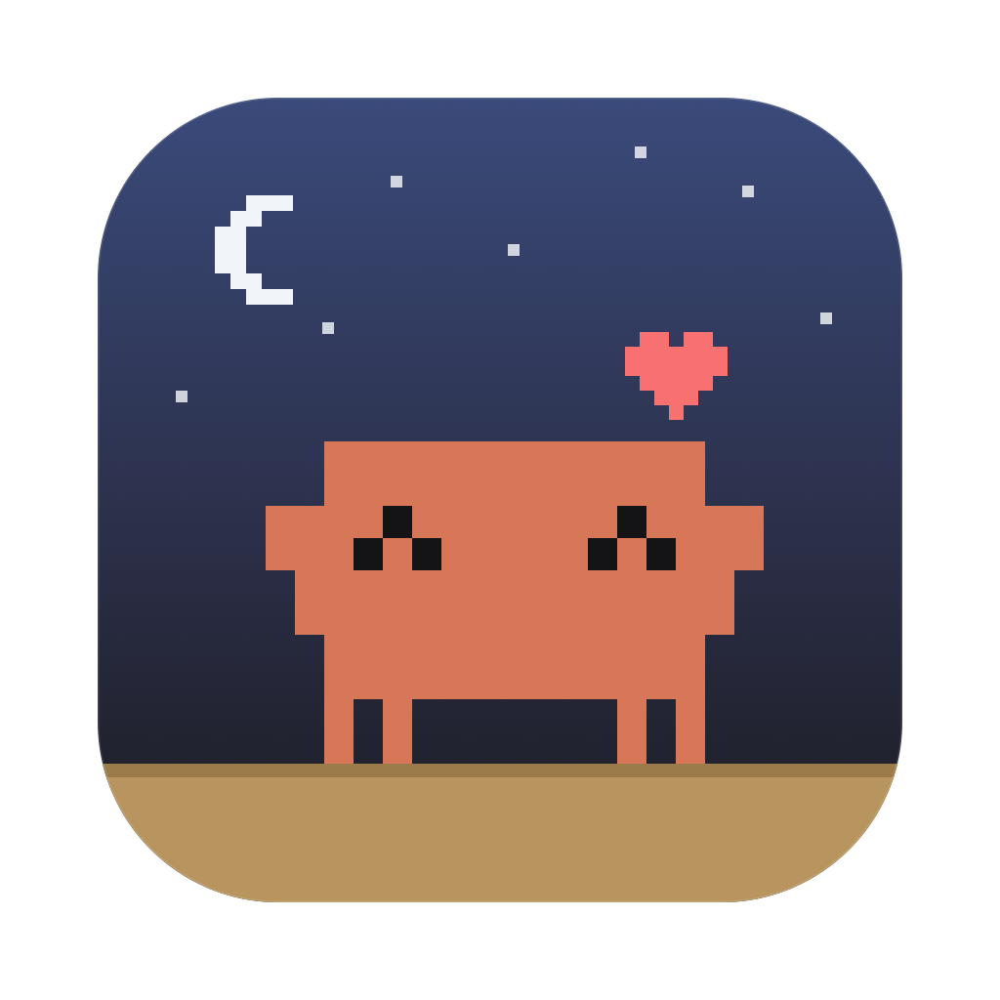
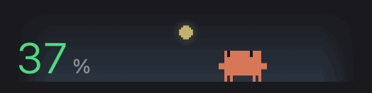
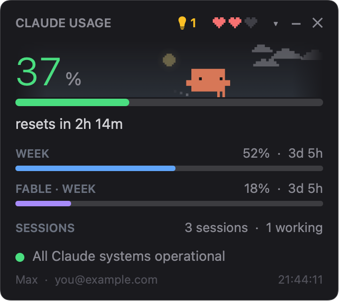
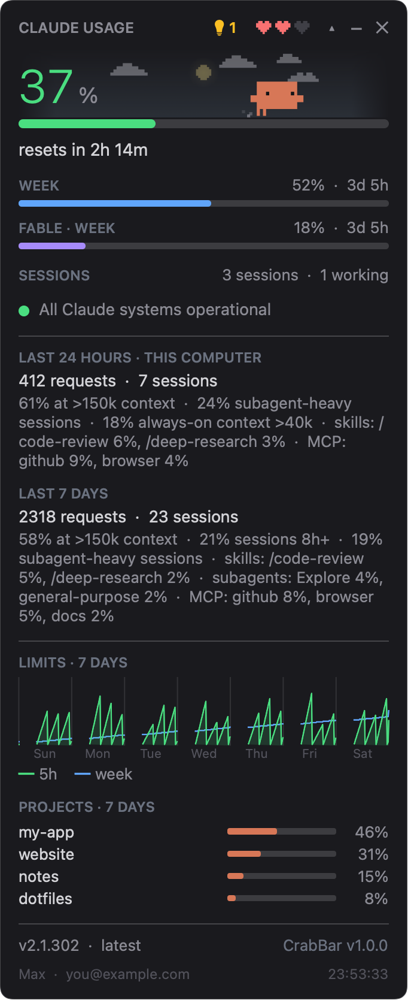
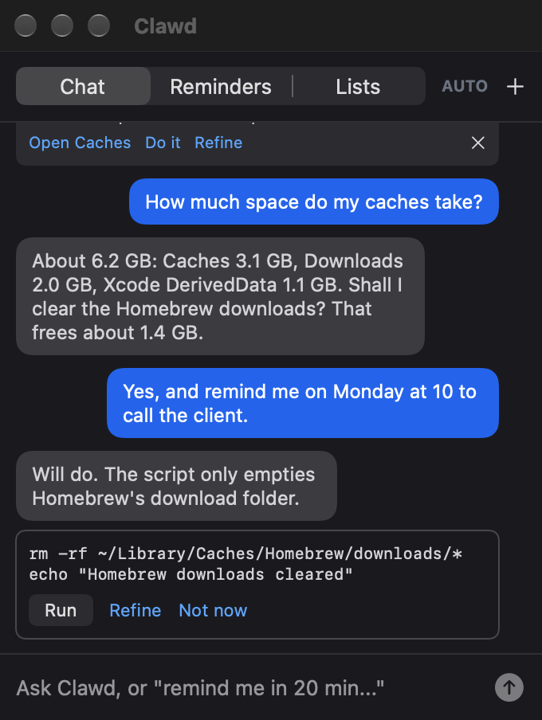
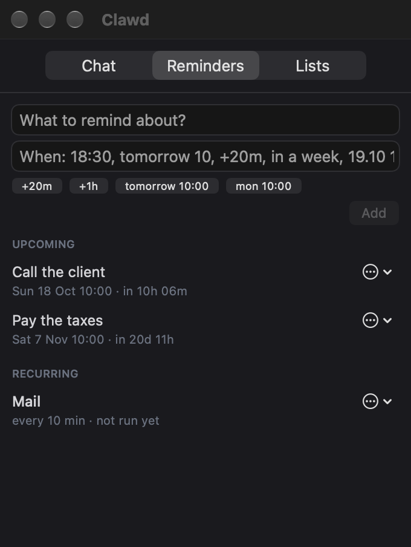
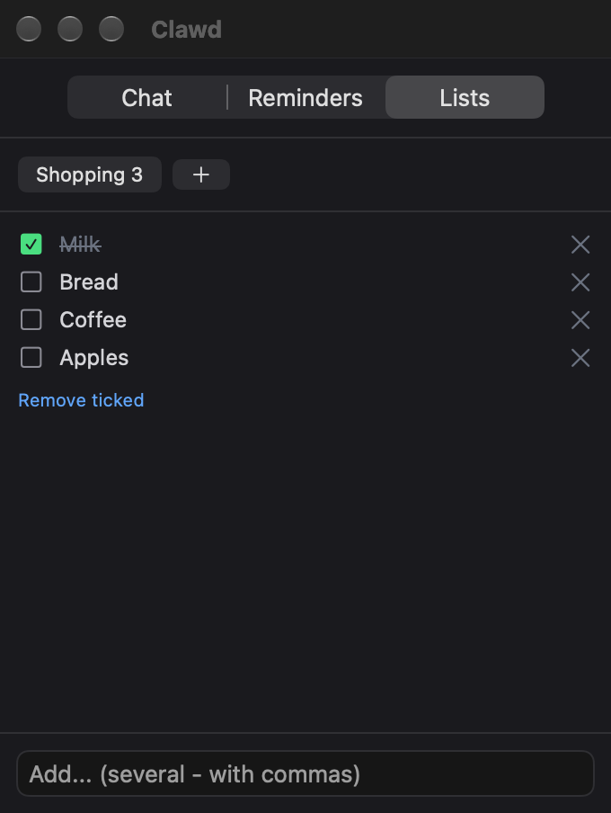
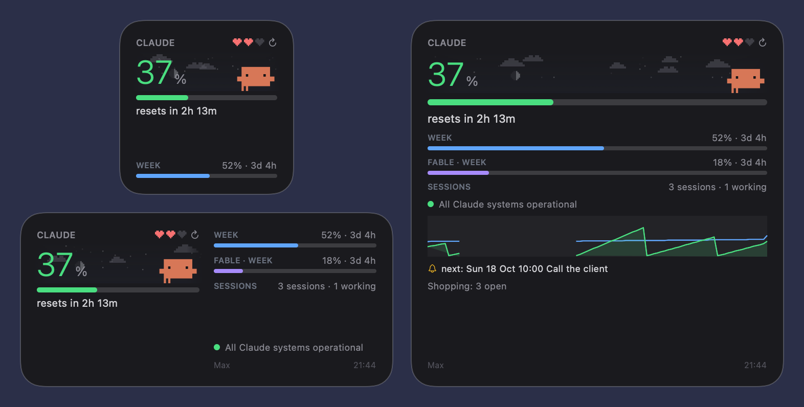
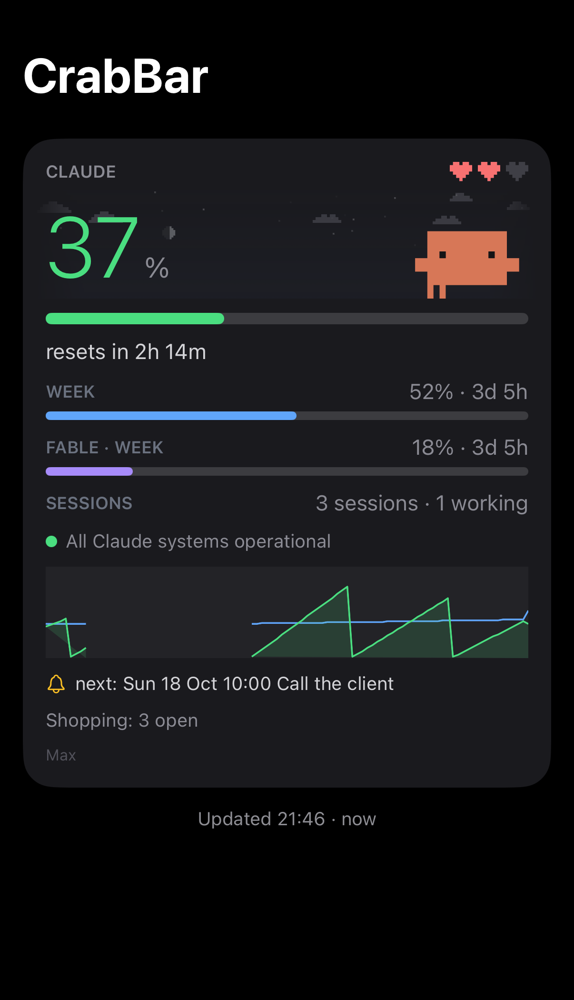

<p align="center"></p>

# CrabBar

**English** · [Deutsch](README.de.md)

Claude plan limits in your Mac menu bar, watched over by Clawd the pixel crab. With widgets for the Mac and the iPhone.

A native macOS port of [clawd-usage-winwidget](https://github.com/Enhed/clawd-usage-winwidget) by Venger Sergey. The original is a PowerShell/WPF widget for Windows; this is a menu bar app with WidgetKit widgets, written from scratch in Swift and following the original's behaviour closely, as of its version 1.6.0 plus a few features from later versions.

It shows your Claude plan limits the way `/usage` does, with Clawd, the pixel crab from the Claude Code welcome screen, living on a sky that follows the real sunrise, sunset and weather. It also shows your running Claude Code sessions and the status of status.claude.com, and gives Clawd his assistant: a chat, reminders, lists, recurring tasks and tips for keeping the Mac tidy.

> Unofficial project. Not affiliated with, endorsed by or supported by Anthropic. Claude, Claude Code and the Clawd character belong to Anthropic; the MIT license covers this code only, not Anthropic's names or artwork.

<p align="center"></p>

## Features

- **Limits**: current 5-hour session, week (all models) and the separate Fable week, with reset countdowns. Green below 60 %, yellow from 60 %, red from 85 %.
- **Menu bar icon**: a circle in the level colour with the session percentage. A left click opens the card, a right click opens the menu. The card can also float freely on the desktop.
- **Clawd**: every animation of the original, frame by frame. He sleeps in the sand when nothing runs, wanders when sessions are idle, runs while one is working, hops with a "?" when a session waits for you, lies down when the limit is used up, and celebrates a reset with confetti. Three hearts show how much of the session limit is left. A right click opens the developer menu with a demo of everything.
- **Sky**: gradient phases from the real sun times, sun and moon (in its real phase) on an arc, stars, clouds, fog, rain, snow and lightning from the current weather.
- **Details**: requests and the "what's contributing" lines from `/usage` for 24 h and 7 days, a 7-day chart of both limits, and the top projects estimated from your local transcripts.
- **Widgets**: small, medium and large, with a refresh button.
- **iPhone**: a companion app with the same Home Screen widgets plus a ring and a rectangle for the Lock Screen. The data comes from the Mac through your private CloudKit database.
- **Clawd's panel**:
  - Chat with Clawd, a headless `claude -p` in his own folder. Scripts he proposes run only after you click Run.
  - Reminders, also repeating ones (daily, weekly, monthly, yearly), with a card and snooze chips when they fire.
  - Lists.
  - Recurring tasks run in the background, every so often or at set times of day; they tell you only what is worth telling.
  - Mac tips: low disk space, caches and other junk, new login items, apps not opened for a long time, pending updates, memory and CPU hogs.
- **Remote Control** (optional): keeps Clawd's own Claude Code session running so you can talk to him from your phone.
- English and German.

## Screenshots

All pictures come from the demo mode with made-up data (see [Build](#build)).

| The card | With details |
|---|---|
|  |  |

| Clawd's chat | Reminders and tasks | Lists |
|---|---|---|
|  |  |  |

**Widgets on the Mac**



**iPhone app** (the iPhone widgets use the same layouts)



## Requirements

- macOS 15 or later, Xcode 26 or later; the iPhone app needs iOS 18 or later
- [XcodeGen](https://github.com/yonaskolb/XcodeGen): `brew install xcodegen`
- Claude Code with `/usage` support in print mode (around 2.1.2xx and later). The app picks the newest `claude` it can find, including the copy bundled with the Claude desktop app; a fixed path can be set in the settings.
- An Apple developer team for signing (a free personal team works for running it locally). Syncing to the iPhone needs iCloud and push, so it needs a paid Apple Developer Program membership. With a personal team, keep `CLAWD_ICLOUD = NO` in `Config/Local.xcconfig` (the template's default); the Mac app then runs without the sync.

## Build

1. Clone the repo, copy the signing template and enter your team ID and a bundle ID prefix of your own:

   ```bash
   git clone https://github.com/Breitec/crabbar.git && cd crabbar
   cp Config/Local.xcconfig.example Config/Local.xcconfig
   ```

   Without `Config/Local.xcconfig`, Xcode signs the app to run locally only. That is enough to try the card, but the widgets may stay empty, because their App Group is named after your team.

2. Generate the Xcode project and build:

   ```bash
   xcodegen generate
   xcodebuild -project CrabBar.xcodeproj -scheme CrabBar -configuration Release -destination 'generic/platform=macOS' -derivedDataPath build -allowProvisioningUpdates build
   ```

3. Copy `build/Build/Products/Release/CrabBar.app` to `/Applications` and start it. Add the widgets via right click on the desktop → Edit Widgets.

   On the first build with iCloud, `-allowProvisioningUpdates` creates a Mac development profile and registers the iCloud container in your developer account. Containers can't be deleted later. Xcode needs the team's Apple Account under Settings → Accounts for this.

4. The iPhone app, in the Simulator:

   ```bash
   xcodebuild -project CrabBar.xcodeproj -scheme CrabBariOS -destination 'generic/platform=iOS Simulator' -derivedDataPath build build
   ```

   For your own iPhone, run the `CrabBariOS` scheme from Xcode on the device. Automatic signing registers the app IDs with iCloud, push and the App Group.

Tests for the shared core (parsers, rules, file formats, mascot):

```bash
cd Packages/ClawdCore && swift test
```

For checking the UI without screen recording permission, `CrabBar.app/Contents/MacOS/CrabBar --render <folder>` writes PNGs of the card, the panel and the settings after about 40 seconds. More switches:

- `--demo`: made-up, fixed data (projects such as "my-app", neutral stats, `you@example.com`, a sample chat, reminders and a shopping list). Nothing is read from or written to your files, the widget data or iCloud; Clawd's folder is a temporary one. With `--render` it also draws the widgets. The screenshots in this README come from it.
- `--gif`: with `--render`, also writes `clawd.gif`, the animation at the top of this README.
- `--lang en|de`: the language for the pictures. `--anonymize`: replaces the real account in the footer.

```bash
open -n build/Build/Products/Release/CrabBar.app --args --demo --render ~/Desktop/crabbar-shots --lang en --gif
```

The iPhone app knows `--demo` too. Boot a simulator (`open -a Simulator`), install the build from step 4 and start it:

```bash
xcrun simctl install booted build/Build/Products/Debug-iphonesimulator/CrabBar.app
xcrun simctl launch booted <BUNDLE_ID_PREFIX>.CrabBariOS --demo
```

## Updating

CrabBar asks GitHub once an hour whether there is a newer release. If so, the details show "CrabBar 1.1.0 available" instead of the version, and the right-click menu gets an entry. Both open the release page. Nothing is downloaded or installed. To update, fetch the new code, generate the project again (new source files only get in this way) and build:

```bash
git pull
xcodegen generate
xcodebuild -project CrabBar.xcodeproj -scheme CrabBar -configuration Release -destination 'generic/platform=macOS' -derivedDataPath build -allowProvisioningUpdates build
```

Then quit CrabBar, copy the new `build/Build/Products/Release/CrabBar.app` to `/Applications` as in step 3 and start it.

The check can be turned off under Settings → Data → CrabBar or with `"updateCheck": false`. The app's version comes from `MARKETING_VERSION` in `project.yml`. A GitHub release tagged `v1.1.0` (not a draft or pre-release) is what the check finds.

## Usage

### Menu bar icon

A left click on the icon opens the card in a popover. A second click on the icon, or a click anywhere else, closes it.

A right click opens the menu:

- The first line shows which Claude Code version the app uses. Below it, **CrabBar 1.1.0 available…** appears when GitHub has a newer release and opens its page.
- **Floating window** shows or hides the card as a window of its own (see below).
- **Open Clawd's panel** opens the chat, reminders and lists.
- **Refresh now** asks `/usage`, status.claude.com and the account at once instead of waiting for the next interval.
- **Larger** and **Smaller** change the size of the card in steps of 0.1.
- **Look the Mac over now** runs the check for the Mac tips and opens the chat in Clawd's panel.
- **Clawd's session with Remote Control** turns Clawd's own Claude Code session on or off. **Restart Clawd's session** ends it, and the app starts it again shortly after.
- **Language** switches between System, Deutsch and English.
- **Settings…**, **Open config.json** and **Quit**.

The tooltip of the icon shows the session percentage with the time until its reset, plus the week and Fable percentages. With **Tooltip with reset clock times** (Settings → General) it shows the clock times of the resets instead of the countdown. If the app can't find `claude` or it is too old, the tooltip shows the error message instead.

### The card

- Right of the title **CLAUDE USAGE** the header holds the symbol for Clawd's panel, Clawd's hearts and three buttons: ▾/▴ (**Details**) shows or hides the details, – (**Hide**) closes the popover, ✕ (**Quit**) ends the app.
- The symbol shows what is waiting and opens Clawd's panel when clicked: a bell for a due reminder, a blue speech bubble when Clawd replied, a light bulb with the number of Mac tips, otherwise a grey speech bubble.
- The hearts show how much of the session limit is left; their tooltip gives the percentage.
- A right click on the header opens the same menu as the menu bar icon.
- The tooltip of the **SESSIONS** line lists the running sessions with their folders. A click on the status line opens status.claude.com.
- In the details, the Claude Code line shows whether a newer version exists. If it says "… available · what's new?", its tooltip lists the changes and a click runs `claude update` in a Terminal window. Otherwise a click opens the changelog on GitHub.
- Next to it, "CrabBar v1.0.0" turns into "CrabBar 1.1.0 available" when there is a newer release. Its tooltip lists the release notes, and a click opens the release page.
- The footer shows plan and account and the time of the last `/usage` answer. "stale" appears in front of the time when that answer is older than three intervals plus 30 seconds (3.5 minutes with the default 60 s).

### Clawd

- With the cursor over the card, Clawd looks toward it. When sessions sit idle for 10 minutes he dozes off; the cursor over the card keeps him awake.
- A click on Clawd plays a random animation, and a small heart rises above him. When he lies flat at the limit, his soul leaves instead; when he sleeps buried in the sand, he peeks out.
- He waves when he has replied in the chat or a task has reported something while the panel was closed, and hops when a reminder is due.
- A right click on Clawd or on the sky opens the developer menu. **Auto (live data)** goes back to the real data, **Show everything in turn** plays every state and animation. **State**, **Animation**, **Hearts** and **Sky** force a single one, **Sweating near the limit** turns on the sweat, and **Play losing hearts** (under **Hearts**) shows the hearts running out.
- Clawd and the sky only move while the popover or the floating window is on screen.

### Floating window

- **Floating window** in the menu, or Settings → General → Floating window → **Show**, puts the card on the desktop as a borderless window. It appears on every Space.
- Drag the card to move it. The position is saved in `config.json` (`left`, `top`).
- **Always on top** and **Opacity** are in the same settings section. **Larger** and **Smaller** or the **Scale** slider set the size.
- In the floating window, – (**Hide**) closes the window; ✕ still quits the app.

### Clawd's panel

The panel opens from the symbol in the card, from **Open Clawd's panel** in the menu or with `open crabbar://panel`. It has three tabs.

**Chat**

- Write a message and press Return. Each message is a `claude -p` call in Clawd's folder with the chat model (default `sonnet`). While Clawd answers, "Clawd is thinking · N s" appears with a stop button. After the timeout (default 300 s) the app cancels the call.
- Clawd may only read. He proposes changes as a script card with **Run**, **Refine** and **Not now**. **Run** starts the script with zsh in Clawd's folder; it may run for up to 24 hours, and a stop button ends it sooner. Clawd then gets the output and says what came of it. A new message from you replaces script cards that are still open.
- **AUTO** at the top (yellow when on, the same switch as **Auto: run scripts without a click** in the settings) runs the chat's scripts without the click; a script a recurring task proposes still waits for it. After three scripts in a row the next one waits for a click again; your next message resets the count.
- **+** starts a new conversation.
- Mac tips appear above the chat under **TIPS**. A link opens the matching place (for example **Storage settings**), **Do it** hands the tip to Clawd, **Refine** lets you say what should happen, × dismisses it and ↻ (**Look again**) checks again.
- If a recurring task names tools beyond reading (an MCP server, a command, a website), or a run was refused a tool, a card **Allow task "…" to use:** lists them. **Allow** approves them for that task and runs it again, **Not now** leaves things as they are. The card shows the task's whole text, with characters that don't show written as [U+…], and when and with which model it runs. If the task file changes later (its text, tools, model or times), the card comes again. Until you allow it, the task's row says it waits for your approval, and **Run now** shows the card again. The chat may use the approved tools of tasks that are not paused as well. Of an MCP server approved as a whole, only reading calls run at once; for other calls Clawd shows a **Clawd wants to:** card, and they run after you click **Run**. A new message replaces such a card while it is open. With AUTO these calls run at once.
- Messages from Clawd's Remote Control session appear in the same chat, marked **Remote Control**.

**Reminders**

- Enter the text and the time, then **Add**. The time field understands for example `18:30`, `tomorrow 10`, `+20m`, `in a week` and `19.10 14:00`; the chips below fill it in. What the field doesn't understand, Clawd works out with the quick model (default `haiku`) when you save. A time that starts with "every", "daily" and the like goes to the chat, and Clawd sets it up as a repeating reminder, or as a recurring task when something has to be done each time.
- **UPCOMING** lists the planned reminders; ↻ marks a repeating one with how often it repeats. The ⋯ menu has **Change**, **+1 hour** and **Delete**. A repeating one stays repeating when changed or moved, from its new time.
- **RECURRING** lists the tasks from `~/Clawd/tasks` with interval or times of day and state. The ⋯ menu has **Run now**, **Pause** or **Resume**, **Open** (the Markdown file) and **Delete**. A click on a task shows its last reports. Tasks wait while the session or week value is at or above **Tasks wait from** (default 80 %).
- **RECENTLY** shows reminders that have fired, each with **again**.
- When a reminder is due, a card appears at the bottom right with a sound. **+15m**, **+1h**, **+3h** and **tomorrow 9:00** put it off, **…** opens this tab with the text filled in, **Done** closes the card. The reminder also shows up in the chat.

**Lists**

- Each list has a button with its number of open entries. **+** creates a new list (Esc cancels). If Clawd's folder has no `lists` folder yet, the app creates it with the list "Shopping".
- A click on an entry ticks it off, × removes it. **Remove ticked** clears the ticked entries; an empty list shows **Delete list**.
- The field at the bottom adds entries, several at once separated by commas.

### Clawd's Remote Control session

With **Clawd's session with Remote Control** on, the app keeps an interactive `claude` running in Clawd's folder, with Remote Control under the name from **Session name** (Settings → Clawd, default `crabbar`). The first time, while Claude Code doesn't trust the folder yet, the session opens in Terminal so you can answer the trust question. After that it runs hidden. Quitting CrabBar ends the hidden session.

### Widgets

- Right click on the desktop → **Edit Widgets**, search for CrabBar and pick small, medium or large.
- Small shows the session with Clawd and the sky, the reset and the week. Medium adds Fable, sessions, status, plan and time. Large adds the 24-hour chart, the next reminder and open list entries.
- ↻ in the widget asks the running app to query `/usage` now and reloads the widget about 4 seconds later. If CrabBar isn't running, the button brings nothing new.
- A click anywhere else on the widget opens the card and starts CrabBar if needed.
- The widget shows the last snapshot the app wrote, with a still Clawd. Changes to what it shows prominently (percentages, resets, Clawd's state, status, the next reminder) reach it at most once a minute, smaller changes wait up to 5 minutes. When the app stops, the widget marks the numbers "stale" after about 3.5 minutes.
- Shortcuts and Spotlight know the action **Refresh Claude usage**, which asks the app to query `/usage` right away.

### Settings and config.json

- **Settings…** opens a window with three pages. **General**: language, **Launch at login**, size, menu bar icon, floating window, what the card shows and the colour thresholds. **Data**: location for the sky, intervals, the iCloud upload for the iPhone, the update check and the path to `claude`. **Clawd**: Clawd's folder, models, timeout, Auto, recurring tasks, Remote Control and Mac tips.
- Text fields are saved on Return or when you leave the field.
- Apart from **Launch at login**, which macOS keeps itself, all settings live in `~/Library/Application Support/CrabBar/config.json`. The app checks the file on every tick (every 10 seconds by default, **Tick** under Data → Intervals) and applies changes while it runs. Keys it doesn't know stay in the file when the app saves.
- The file has the keys of the original 1.6.0, without the Windows-only ones and `clawdSessionHidden` (Clawd's session always runs in the background here), plus a few for macOS: `floating`, `menuBarPercent`, `weatherUseLocation`, `weatherIPLookup`, `claudePath`, `iCloudSync` and `updateCheck`. Most keys are also in the settings window.
- Claude Code's folder: CrabBar reads `~/.claude` (sessions, projects, transcripts, `settings.json` for the update channel) and `~/.claude.json` (whether Claude Code trusts Clawd's folder). With the environment variable `CLAUDE_CONFIG_DIR` set to an absolute path (or one starting with `~/`), it reads that folder instead, and `.claude.json` inside it, as Claude Code does; any other value counts as unset. An app started from the Finder or at login doesn't see shell variables, so CrabBar takes `CLAUDE_CONFIG_DIR` from your login shell at start, together with `PATH`, and hands it on to the `claude` processes it starts. With zsh (the macOS default) a login shell reads `~/.zprofile` and `~/.zshenv`, not `~/.zshrc`, so export the variable in one of those; with bash, in `~/.bash_profile`. After changing it, quit and start CrabBar again.

### iPhone

- The iPhone gets its data only from the Mac. CrabBar has to run on the Mac, built with iCloud (`CLAWD_ICLOUD = YES`) and with **Send to the iPhone via iCloud** on (Settings → Data → iPhone, on by default). Both devices need the same Apple Account.
- The app shows the content of the large widget as a card: session, Clawd, sky, reset, week, Fable, sessions, status, the 24-hour chart, the next reminder, open list entries and the plan. Pull down to fetch the latest record; the app also fetches it whenever it comes to the front.
- The Home Screen widgets (small, medium, large) look like the ones on the Mac. On the Lock Screen there is a ring with the session percentage and a rectangle with Clawd, session, reset and week. ↻ in the Home Screen widget fetches the latest record from iCloud; it can't make the Mac run `/usage`.
- The language follows the setting on the Mac (with System, the iPhone's own).
- After about 28 minutes without new data the app shows "The Mac app needs to be running" and "No new data from the Mac since …". The Home Screen widgets put "stale" in yellow in front of the reset line or the time, the Lock Screen rectangle shows "stale" as well, and the ring turns grey and pale.

## Troubleshooting

### "Claude Code (claude) was not found"

The app doesn't search the shell's `PATH` for `claude` but fixed places: `~/.local/bin`, `/opt/homebrew/bin`, `/usr/local/bin`, `~/.claude/local` (and `local` in `CLAUDE_CONFIG_DIR`), `~/.npm-global/bin`, `~/.bun/bin`, `~/.local/share/claude/versions/` and the copy inside the Claude desktop app. Install Claude Code with the command from the message, or enter the path under Settings → Data → **Path to claude** and click **Search again**. The line below the field shows which `claude` the app uses and its version. The app also searches again by itself once an hour.

### "This Claude Code is too old for /usage"

`claude -p /usage` answered "/usage isn't available in this environment": the installed Claude Code is too old for `/usage` in print mode. Run `claude update`, or click the version line in the details when it offers an update. With several copies installed the app takes the newest, but a fixed **Path to claude** wins; empty that field if it points to an old copy.

### "not logged in: claude /login"

`claude auth status` reports that nobody is logged in. Start `claude` in Terminal and log in with `/login`.

### Sessions are not counted

CrabBar reads the list of running sessions that Claude Code keeps in `~/.claude/sessions/<pid>.json` (or in `sessions` in `CLAUDE_CONFIG_DIR`, see [Settings and config.json](#settings-and-configjson)). A file counts only while its process is alive and was started at the time written in the file (±5 seconds). Processes CrabBar starts itself (chat, tasks, `/usage`) don't count, and neither does Clawd's own Remote Control session while it is idle. Check with `ls "${CLAUDE_CONFIG_DIR:-$HOME/.claude}"/sessions` while a session runs. If the folder stays empty, this Claude Code doesn't write the list; run `claude update`. The **SESSIONS** line can also be switched off under Settings → General → Display → **Sessions**.

### Widgets don't appear in the gallery

macOS only offers widgets of apps it knows. Copy `CrabBar.app` to `/Applications`, start it once from there and open **Edit Widgets** again. A widget that says "Open CrabBar on the Mac" has no snapshot yet; it fills in once the app runs.

### Signing fails with a personal team

A free personal team can't sign iCloud and push, and Xcode reports "Personal development teams … do not support the iCloud capability". Either set `CLAWD_ICLOUD = NO` in `Config/Local.xcconfig` (the Mac app then builds without the iPhone sync; the iPhone app always needs iCloud and therefore the paid program), or join the paid Apple Developer Program and set `CLAWD_ICLOUD = YES`.

### "No Accounts"

`-allowProvisioningUpdates` needs the team's Apple Account in Xcode. Add it under Xcode → Settings → Accounts and build again.

### "Device … isn't registered in your developer account"

A signed Mac build with iCloud and a build for your own iPhone both need the device in the team's device list. Adding `-allowProvisioningDeviceRegistration` to the Mac build command registers the Mac:

```bash
xcodebuild -project CrabBar.xcodeproj -scheme CrabBar -configuration Release -destination 'generic/platform=macOS' -derivedDataPath build -allowProvisioningUpdates -allowProvisioningDeviceRegistration build
```

For the iPhone the same holds. If you run the `CrabBariOS` scheme from Xcode on the connected iPhone, automatic signing registers it. With `xcodebuild`, add `-allowProvisioningDeviceRegistration`:

```bash
xcodebuild -project CrabBar.xcodeproj -scheme CrabBariOS -destination 'platform=iOS,name=<your iPhone>' -derivedDataPath build -allowProvisioningUpdates -allowProvisioningDeviceRegistration build
```

### "Bad Container" right after the first iCloud build

The first build registers the iCloud container, and for a few minutes after that CloudKit may answer "Bad Container". Settings → Data → iPhone then shows "iCloud: …" in orange. CloudKit usually sends a retry hint with this error; the app then tries again after about a minute, so the first upload goes through a few minutes later. Without a hint it waits 30 minutes; quit and restart CrabBar to try sooner. Once an upload works, the log says `icloud: snapshot uploaded`.

### The iPhone shows no data or old data

- On the Mac, Settings → Data → iPhone should show "Last sent to iCloud at …". "This build has no iCloud entitlement." means the Mac app was built with `CLAWD_ICLOUD = NO`. An error shows up as "iCloud: …" in orange.
- After launch the Mac app uploads only once the first `/usage` numbers (or an error message) are there, so an empty card never replaces the last good one.
- Mac and iPhone must be signed in to iCloud with the same Apple Account. If the iPhone isn't signed in, its app says "Sign in to iCloud so the data from your Mac can arrive."; with different accounts it stays at "No data from the Mac yet".
- Apps built from Xcode use the CloudKit environment "Development", an iPhone app from TestFlight reads "Production" (see [iPhone and iCloud](#iphone-and-icloud)).
- Silent pushes don't always arrive. Opening the app or pulling down in it fetches the record; the widgets also ask iCloud by themselves about every 15 minutes.
- The numbers count as stale after about 28 minutes without an upload. A Mac that sleeps or doesn't run CrabBar uploads nothing.

### Log file

The app writes problems to `~/Library/Application Support/CrabBar/widget-error.log`, one line each with an ISO timestamp: failed `/usage` calls (`usage: exit …`), iCloud errors (`icloud: …`), and `icloud: snapshot uploaded` for the first upload after launch and whenever uploads work again after an error.

```bash
tail -n 50 ~/Library/Application\ Support/CrabBar/widget-error.log
```

Settings → Data → iPhone shows the time of the last successful upload ("Last sent to iCloud at …") or the last error. Nothing there means the app hasn't uploaded since it started.

## Uninstall

1. Turn off **Launch at login** (Settings → General) and **Clawd's session with Remote Control**. If that session once opened in Terminal, close that window too. Then quit CrabBar. A login item left behind can be removed later under System Settings → General → Login Items & Extensions.

2. Delete the app and its data:

   ```bash
   rm -rf /Applications/CrabBar.app
   rm -rf ~/Library/Application\ Support/CrabBar
   rm -rf ~/Library/Group\ Containers/<TEAM_ID>.<BUNDLE_ID_PREFIX>.crabbar
   rm -rf ~/Library/Containers/<BUNDLE_ID_PREFIX>.CrabBar.Widget
   rm -f "$TMPDIR"/clawd-*
   ```

   - `Application Support/CrabBar`: settings, `/usage` history, chat history, the state of tasks, tips and Clawd's session, the token cache for the projects, the log file and the prompts for Claude.
   - `Group Containers/…`: the snapshot that app and widget share. Team ID and prefix are the values from `Config/Local.xcconfig`.
   - `Containers/….CrabBar.Widget`: the sandbox container of the widget extension.
   - `$TMPDIR/clawd-*`: Terminal scripts for `claude update` and the first start of Clawd's session.

   macOS may ask whether Terminal may access data from other apps.

3. Clawd's folder `~/Clawd` (or the one set under **Clawd's folder**) holds your reminders, lists and tasks plus `tips.md` and `chat-log.md`. Delete it only if you don't need them any more: `rm -rf ~/Clawd`.

4. Claude Code keeps the transcripts of the panel chat and of Clawd's Remote Control session in `~/.claude/projects/` (with `CLAUDE_CONFIG_DIR` set, in `projects` there), in a folder named after the path of Clawd's folder:

   ```bash
   rm -rf "${CLAUDE_CONFIG_DIR:-$HOME/.claude}"/projects/"$(printf %s "$HOME/Clawd" | sed 's/[^A-Za-z0-9]/-/g')"
   ```

   If you answered the trust question, Claude Code remembers that in `~/.claude.json` (or in `.claude.json` in `CLAUDE_CONFIG_DIR`). The entry does no harm.

5. iCloud: the container `iCloud.<BUNDLE_ID_PREFIX>.crabbar` stays in your developer account, as containers can't be deleted. Its content is one record (`current` in the zone `CrabBar`) in your private database, plus the push subscription `clawd-snapshot` of the iPhone app. To clear it, stop the upload first (step 2 or `"iCloudSync": false`), because the Mac app creates the zone again on its next upload. Then open the container in the CloudKit Console (icloud.developer.apple.com), pick the environment (Development for builds from Xcode), sign in to the private database with "Act as iCloud Account" and delete the zone `CrabBar`. App IDs and App Groups can be removed under Certificates, Identifiers & Profiles.

6. iPhone: delete the CrabBar app. This also removes its widgets and the copy of the snapshot in its App Group.

## How it works

| What | Where it comes from |
|---|---|
| Limits | `claude -p /usage --output-format text --no-session-persistence` every 60 s; no model call, no tokens |
| Account | `claude auth status` |
| Sessions | `~/.claude/sessions/*.json`, counted only while the process is alive and is the same process |
| Projects | `~/.claude/projects/**/*.jsonl`, read incrementally |
| Status | status.claude.com |
| Versions | downloads.claude.ai, changelog from GitHub |
| CrabBar releases | api.github.com, once an hour |
| Weather | Open-Meteo, met.no as a fallback; location from the settings or macOS Location Services |
| iPhone | the snapshot the Mac app uploads to your private CloudKit database |

`~/.claude` stands for the folder in `CLAUDE_CONFIG_DIR` when that is set.

The app runs outside the App Sandbox because it starts `claude` and reads `~/.claude`. That is also why it is not meant for the App Store. The widget extension is sandboxed and gets its data from a snapshot in a shared App Group.

### iPhone and iCloud

The Mac app writes the same snapshot as one record into the private database of the container `iCloud.<BUNDLE_ID_PREFIX>.crabbar` (from `Config/Local.xcconfig`) (zone `CrabBar`, record `current`), with the payload in an encrypted field. It uploads at most every 60 seconds when something visible changed, and otherwise every 10 minutes as a heartbeat. Right after launch it waits for the first numbers, so an empty card never replaces the last good one.

The iPhone app saves a `CKDatabaseSubscription` with silent pushes. On a push it fetches the record, keeps it in its App Group and reloads the widgets. When pushes don't arrive, the widget asks CloudKit itself on its next reload, roughly every 15 minutes. The refresh button in the iPhone widget fetches the latest record; it can't make the Mac run `/usage`.

On the iPhone the numbers count as stale after about 28 minutes without news (the Mac's interval, the heartbeat and the widget's reload taken together), and the app then says that the Mac app needs to be running.

Apps built from Xcode use the CloudKit "Development" environment. An iPhone app from TestFlight talks to "Production"; the Mac app then has to write to Production as well (entitlement `com.apple.developer.icloud-container-environment`), and the schema has to be deployed to Production in the CloudKit Console first.

| Part | Contents |
|---|---|
| `Packages/ClawdCore` | Code shared by app and widget: `/usage` parser, formatting, Clawd's sprites and animations, sky engine, weather, file formats, reminder time parser, widget snapshot |
| `CrabBar/` | The menu bar app |
| `CrabBarWidget/` | The WidgetKit extension |
| `WidgetShared/` | Widget layouts shared by the Mac and iPhone widgets |
| `CrabBariOS/` | The iPhone app: a card with the numbers, silent pushes, the snapshot in its App Group |
| `CrabBariOSWidget/` | The iPhone widgets for the Home Screen and the Lock Screen |
| `tools/make-icon.sh` | Renders the app icon from Clawd's sprite data |

## Privacy and safety

- **No credentials**: the app never reads or stores Claude credentials. It only runs the `claude` CLI and reads its local files.
- **Chat**: Claude may only read: write and edit tools are blocked, and the allowed shell commands are read-only (`ls`, `df`, `du`, `ps`, …). Changes come as a script that waits for your click, unless you turn on Auto.
- **Tasks**: a recurring task that asks for more than reading (an MCP server, a command, a website) runs only after you approve those tools. The approval holds for the task as it was then: if its text, tools, model or times change, also when Claude wrote or changed the file, it asks again, and so it does when a paused task runs again other than with **Resume** in the panel. Pausing and the limit don't ask. A task's reply can't make, change or remove tasks, and a script it proposes waits for your click, also with Auto. Once allowed, a task uses those tools without asking again, and what it reads (a mail, a web page) can steer them: allow a task only what it may do unattended. A whole MCP server includes sending and deleting.
- **Location**: locating by IP through ipwho.is is off by default. Weather requests send coordinates rounded to two decimal places (about 1 km).
- **Update check**: once an hour the app asks api.github.com for the newest CrabBar release. GitHub sees your IP address, as with any web request, and the CrabBar version in the User-Agent; nothing else is sent. Turn it off under Settings → Data → CrabBar or with `"updateCheck": false`.
- **Local data**: settings, chat history and state live in `~/Library/Application Support/CrabBar`. Reminders, lists and tasks are Markdown files in `~/Clawd`.
- **iCloud**: the snapshot for the iPhone lives in your private CloudKit database, its payload in an encrypted field. It includes the next reminder and the names of your lists. The iPhone holds no Claude credentials and never talks to Anthropic. Turn the upload off under Settings → Data → iPhone or with `"iCloudSync": false`.

## Clawd's folder

`~/Clawd` (configurable) holds `reminders/`, `lists/` and `tasks/` as Markdown files in the same format as the original. The panel chat, the background tasks and Clawd's own Remote Control session share it, so a reminder made from the phone fires on the Mac.

A reminder, for example `reminders/2026-11/2026-11-16 10-00 Pay the taxes.md`:

```markdown
---
at: 2026-11-16T10:00
repeat: monthly
---
Pay the taxes
```

- `at`: local time. Without it, the time comes from the file name.
- `repeat` (optional): `daily`, `weekly`, `monthly` or `yearly`. When the reminder fires, its file moves to `reminders/done` and the app writes the file for the next time. If the Mac was off for a few times, the next one is the first after now. A monthly one on the 29th to 31st goes on from the shorter month's last day.

A recurring task, for example `tasks/Mail.md`:

```markdown
---
every: 10m
tools: mcp__mail
hours: 8-23
---
Check the inbox for mail that came since the last run. Tell me only about ...
```

- `every`: `10m`, `2h`, `1d` (at least two minutes). Or instead `at: 09:00, 18:00`: these times of day, each once. If the Mac was asleep or off at one of them, the task runs once when it is on again. A new task waits for its next time instead of running for one already past. With both keys, `at` wins.
- `hours` (optional, only with `every`): only between these hours, `22-7` spans midnight.
- `tools`, `model`, `limit` and `paused: yes` are optional, as in the original.

## Differences from the original

- zsh instead of PowerShell, Mac checks instead of Windows registry checks in the advisor
- no self-update: CrabBar points to a new GitHub release and you build it yourself; no admin elevation
- English and German instead of English, Russian and French
- the reset stamp is read with its time zone, and the newer "Oct 17 at 2:29pm" format is understood
- widgets show a snapshot with a still Clawd; animations, chat and menus live in the app
- an extra iPhone app with widgets that gets its data from the Mac through iCloud
- based on the original's version 1.6.0, plus from later versions: repeating reminders (1.8.0), tasks at set times (`at:`, 1.8.3) and `CLAUDE_CONFIG_DIR` (1.9.3). Not in yet, among others: sessions from other machines (`remoteSessions`), structured replies of recurring tasks, the moon phase in the sky's tooltip, themes and skins and the Claude Code tab in the settings

## License

MIT, see [LICENSE](LICENSE). The original clawd-usage-winwidget is © Venger Sergey under the MIT license; this port keeps that notice.
